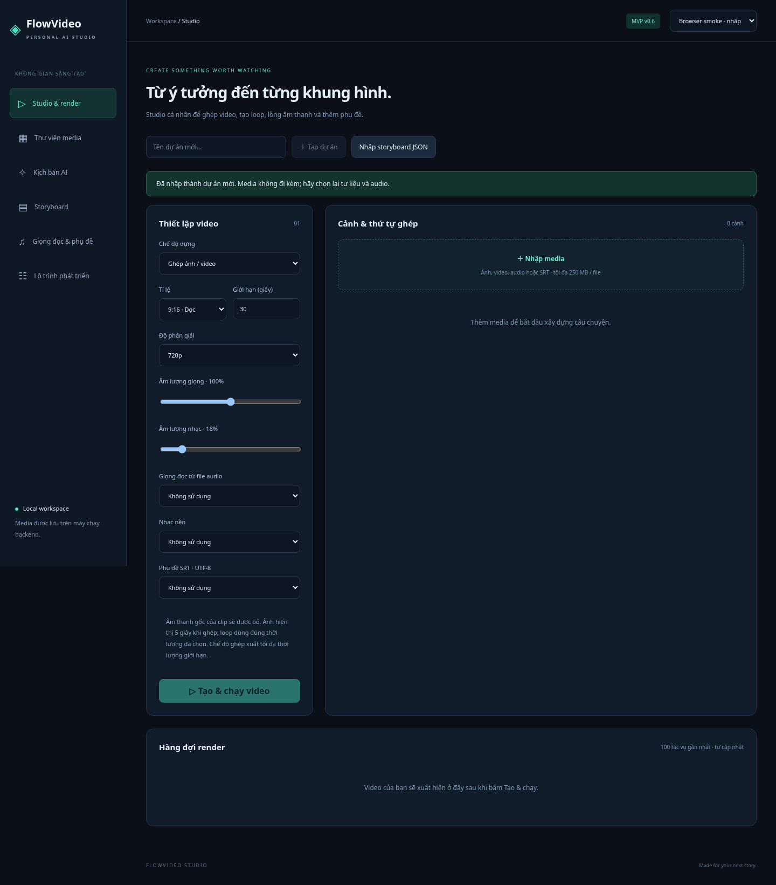

# FlowVideo Studio

[](https://github.com/Trung27012003/flowvideo-studio/actions/workflows/ci.yml)

Studio video cá nhân bằng **Angular 21 + ASP.NET Core / .NET 10 + FFmpeg**. Giao diện tiếng Việt, hàng đợi render lưu bền vững và kho media local.



## Trạng thái v0.1

**Đã triển khai:** tạo/chọn dự án; nhập ảnh, video, audio, SRT; chọn và sắp xếp cảnh; ghép ảnh/video; loop trực tiếp một nguồn; thêm giọng đọc từ file và nhạc nền; burn-in SRT; hàng đợi, thử lại job lỗi; preview/tải MP4; tạo kịch bản AI khi cấu hình API key.

**Chưa triển khai:** sinh video/ảnh AI, text-to-speech, speech-to-text, timeline trim/split, loop crossfade/ping-pong, đăng mạng xã hội, tự động biến kịch bản thành video. Các chức năng này được mô tả trong [roadmap](docs/ROADMAP.md), không giả lập kết quả AI.

## Chạy phát triển

Yêu cầu: .NET 10 SDK, Node.js 24, FFmpeg/ffprobe trong PATH, Python 3 nếu chạy smoke test. Cài font hỗ trợ tiếng Việt, ví dụ DejaVu Sans.

```bash
cd src/Studio.Web
npm ci
cd ../..
bash scripts/dev.sh
```

Mở **http://127.0.0.1:4200**. API chạy tại `http://127.0.0.1:5080`. Angular proxy chuyển `/api` tới backend. Trên Windows, chạy hai lệnh trong hai terminal: `dotnet run --project src/Studio.Api --urls http://127.0.0.1:5080` và `npm start` trong `src/Studio.Web`.

Tạo dự án → nhập media → chọn cảnh theo thứ tự → chọn audio/SRT nếu cần → **Tạo & chạy video**. Job cập nhật mỗi 2,5 giây. Khi hoàn tất, xem hoặc tải MP4.

## AI tùy chọn

Đặt biến môi trường `OPENAI_API_KEY` trong terminal chạy backend; `OPENAI_MODEL` mặc định `gpt-4o-mini`. Không đặt key trong Angular hay commit vào Git. File `.env.example` chỉ là mẫu; ứng dụng **không tự đọc `.env`**. Yêu cầu tạo kịch bản có thể phát sinh phí. Cần model được tài khoản cho phép sử dụng.

Kịch bản AI hiện chỉ hiển thị trong phiên trình duyệt; hãy sao chép trước khi reload. Nó chưa tự tạo media hay đưa vào hàng đợi dựng.

## Quy tắc render hiện tại

- Ghép: ảnh 5 giây/cảnh; video giữ thời lượng nguồn trong giới hạn; đầu ra dừng ở thời lượng media hoặc giới hạn người dùng, tùy giá trị nhỏ hơn.
- Loop: chọn đúng một ảnh/video, lặp trực tiếp đến thời lượng đích; không bảo đảm điểm nối liền mạch.
- Đầu ra: H.264/AAC MP4, 30 fps, 720×1280 hoặc 1280×720; giữ tỉ lệ nguồn bằng letterbox.
- Audio gốc của clip bị bỏ. Giọng đọc là file audio đã nhập, không phải TTS. Nhạc nền giảm về 18%, chưa có auto-ducking.
- SRT phải là UTF-8. Phụ đề được burn-in, chưa có trình sửa sub.
- Tối đa 250 MB/file, 30 cảnh/job, 600 giây; một worker render tuần tự.
- Job Queued còn lại được chạy khi mở lại; job Running bị gián đoạn được đánh dấu Failed để thử lại thủ công.

## Dữ liệu và bảo mật

SQLite và media nằm trong `data/` tương đối với backend; có thể đổi bằng `STUDIO_DATA` (nên dùng đường dẫn tuyệt đối). Không commit dữ liệu, file nguồn hay credentials. Sao lưu toàn bộ thư mục khi backend đã dừng.

**Bản này dành cho một người dùng trên localhost.** Chưa có đăng nhập, phân quyền hay cách ly xử lý file không tin cậy. Không mở API lên Internet/LAN trước khi bổ sung authentication, giới hạn tài nguyên và sandbox media. API key chỉ ở backend; thông tin lỗi chi tiết xem trong log backend.

## Build và kiểm thử

```bash
dotnet build src/Studio.Api -c Release
cd src/Studio.Web && npm ci && npm run build
cd ../..
python3 scripts/smoke.py
```

Smoke test chạy backend với database tạm, tạo media bằng FFmpeg, kiểm tra ghép, loop, audio + SRT, validation, tải MP4 và dữ liệu sau restart. Cần API port 5097 trống.

## Chạy bản build chung một server

```bash
dotnet publish src/Studio.Api -c Release -o publish
mkdir -p publish/wwwroot
cp -r src/Studio.Web/dist/web/browser/. publish/wwwroot/
cd publish
dotnet Studio.Api.dll --urls http://127.0.0.1:5080
```

Trên Windows, copy nội dung thư mục `dist/web/browser` vào `publish/wwwroot` bằng Explorer/PowerShell. CI tạo artifact cùng cấu trúc; máy chạy artifact vẫn cần .NET 10 runtime, FFmpeg và font.

Xem [kiến trúc](docs/ARCHITECTURE.md) và [kế hoạch](docs/ROADMAP.md). Repository trên GitHub lưu mã nguồn và CI; không phải dịch vụ web được hosting công khai.
