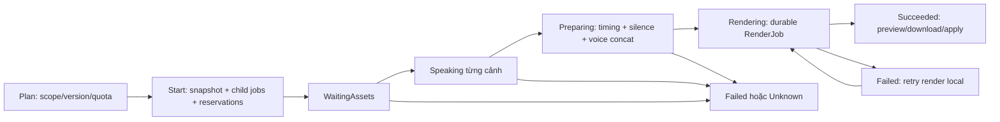

# Kiến trúc v0.10

Angular → HTTP API ASP.NET Core → EF Core SQLite; BackgroundService đọc job queued và gọi FFmpeg. Browser polling theo tải: 2,5 giây khi active, 15 giây khi idle, 30 giây khi lỗi; không gửi khi tab ẩn. Mỗi vòng đợi request hoàn tất trước khi hẹn lần sau; version guard tránh phản hồi cũ ghi đè dự án mới. File dùng ID sinh bởi server, không dùng tên upload làm đường dẫn. FFmpeg arguments được truyền bằng ArgumentList, không qua shell.

## Dữ liệu

Project → Asset và RenderJob. RenderRequest được serialize trong job, lưu danh sách asset có thứ tự, mode, duration, ratio và các audio/subtitle ID. API kiểm tra asset cùng dự án và đúng loại. Assets và exports lưu ngoài database.

## Pipeline

1. Xác thực request rồi lưu Queued.
2. Một worker đổi job thành Running.
3. Chuẩn hóa mỗi cảnh về resolution/frame rate/pixel format chung, bỏ audio gốc.
4. Nối clip, thêm audio và SRT, giới hạn thời lượng, xuất MP4.
5. Đánh dấu Succeeded hoặc Failed và dọn file tạm.

Lần chạy đầu dùng EnsureCreated. v0.4 thêm bảng ProjectDocuments bằng một lệnh CREATE TABLE IF NOT EXISTS có giới hạn rõ, chạy cho cả database mới/cũ; đã kiểm thử giữ nguyên project/media của schema cũ. v0.5 tiếp tục thêm bảng nhật ký ảnh bằng lệnh idempotent; thay đổi cột/bảng hiện có cần chuyển sang migration có phiên bản đầy đủ. Không chạy nhiều instance backend trên cùng data directory; chưa có distributed lock. File upload chưa hợp lệ có thể được nhận rồi thất bại lúc render; bổ sung ffprobe validation là bước kế tiếp.

## Quyết định có chủ ý

SQLite và hosted worker thay PostgreSQL/Hangfire để bản local ít dependency. Chưa cần Redis, Docker hay cloud storage. UI đã hỗ trợ cancel. Endpoint đổi trạng thái bằng update có điều kiện; JobControl liên kết CancellationToken với FFmpeg. Đăng ký token trước khi claim Queued → Running để tránh bỏ lỡ cancel. Hoàn tất cũng là update có điều kiện, nên job đã hủy không thể chuyển lại Succeeded. Chưa có pause. Polling thay SignalR trong bản đầu; có thể thay transport mà không đổi dữ liệu job. AI script dùng API thật, không retry tự động request tính phí.

## Nâng cấp

Tách renderer/provider interface khi thêm provider thứ hai. Tạo Scene, TimelineRevision, ProviderRequest, UsageRecord; lưu model, request ID, tham số và nguồn gốc media. Dùng capability matrix cho từng provider. Thêm authentication trước multi-user; thêm migrations, PostgreSQL và cơ chế claim job nguyên tử trước nhiều worker.

## Render tối ưu và trim

Probe duration với ffprobe; chỉ chuẩn hóa phần clip trong điểm vào/ra và ngân sách còn lại. Tái sử dụng cảnh trùng trong cùng job. Loop chuẩn hóa một chu kỳ nguồn rồi stream_loop ở bước xuất. Dùng video stream copy khi không có phụ đề; burn-in vẫn cần encode. Giới hạn encoder ở hai thread, log tiến trình giữ tail hữu hạn. Xuất vào file tạm rồi move khi xong; job lỗi/hủy không để lại MP4 dở ở exports.

Giữ nguyên schema SQLite hiện có. Cuts được lưu trong RequestJson, job cũ không có Cuts dùng toàn bộ nguồn như trước. API hàng đợi chỉ trả metadata 100 job gần nhất, không trả RequestJson; truy vấn media chỉ tải các asset được tham chiếu.

## Audio và phụ đề v0.3

`AudioProvider` dùng named HttpClient `OpenAiAudio` với endpoint OpenAI cố định. Speech và transcription không tự retry; thời hạn 90 giây bao gồm đọc body. Giọng đọc trả MP3, được ffprobe kiểm tra trước khi lưu asset. STT kiểm tra track audio và giới hạn 600 giây, trích mono MP3 16 kHz/64 kbps rồi gửi multipart `whisper-1`, `verbose_json`. Đầu ra được kiểm tra schema, timestamp và thời lượng trước khi lưu SRT.

`Subtitles` chuẩn hóa UTF-8/newline, kiểm tra thứ tự thời gian và đánh số lại. Lưu SRT luôn tạo asset mới để không sửa file mà render hiện tại có thể đang dùng. Không thay đổi schema database. Audio/sub xử lý đồng bộ theo HTTP request, chưa dùng hàng đợi render; reload/đứt kết nối có thể hủy xử lý local và không đảm bảo dịch vụ AI chưa tính phí.

`Studio.Api.Tests` dùng WebApplicationFactory và HTTP handler mô phỏng cho upstream, nhưng dùng SQLite/FFmpeg thật. CI không dùng key thật hay gọi mạng AI. `FlowVideo.sln` chứa API và test project.

## Storyboard v0.4

ProjectDocuments lưu một bản hiện tại cho mỗi project: JSON ý tưởng/kịch bản/cảnh, Version và UpdatedAt. Tạo lần đầu dựa vào primary key; cập nhật dùng UPDATE có điều kiện Version. Bản cũ nhận 409, không tự ghi đè. Version phục vụ kiểm tra đồng thời, chưa phải lịch sử có thể khôi phục.

Endpoint dựng đọc bản đã lưu theo version yêu cầu, kiểm tra asset cùng dự án rồi tạo RenderJob với snapshot SceneClip. Worker dùng duration/start theo từng occurrence nên một asset có thể dùng lại ở nhiều cảnh. Với video thiếu thời lượng, filter tpad giữ frame cuối; ảnh dùng đúng duration cảnh. SubtitleCue được tính sau normalize bằng thời lượng thực tế của mỗi part, lời rỗng được bỏ qua; phụ đề cảnh được burn-in, chưa thành asset SRT riêng. TTS không được gọi ngầm khi dựng.

Script và board được lưu cùng document. Frontend đọc lại theo project, giữ draft trong RAM đến khi bấm lưu. Component StoryboardEditor tách khỏi App. localStorage chỉ nhớ project ID gần nhất; dữ liệu nội dung nằm ở backend.

## Image generation v0.5

Bảng ImageGenerations lưu request ID, project/scene/version, prompt, model/size/quality, fingerprint, trạng thái, asset ID, provider request ID khi có và thời gian. CREATE TABLE/INDEX IF NOT EXISTS bổ sung cho schema cũ, không sửa dữ liệu cũ. Startup chuyển Running thành Unknown, giữ Queued để worker tiếp tục. Worker ảnh riêng, một request tại một thời điểm, claim bằng UPDATE có điều kiện.

Intake dùng semaphore trong một backend để kiểm tra idempotency, scene/version, reuse và rolling quota trước khi insert. Worker dùng cùng gate khi commit trạng thái cuối để completion không lọt giữa bước đọc cache và kiểm tra active rồi tạo lượt trùng. Chỉ hỗ trợ một backend dùng chung data directory; đây không phải giới hạn phân tán. Quota đếm cả lỗi/Unknown, không rollback phí hay ước lượng tiền. Succeeded cùng scene/prompt/model/size/quality được reuse khi asset/file còn tồn tại; lịch sử giữ nguyên và không gắn ảnh vào document tự động.

ImageProvider chỉ gọi endpoint OpenAI cố định, không retry; 90 giây bao gồm body, tối đa 24 MiB JSON và 16 MiB PNG giải mã. Kiểm tra PNG header, codec/dimensions bằng ffprobe rồi decode/re-encode một frame bằng FFmpeg trước khi lưu asset. File tạm/lỗi được dọn. Network/timeout → Unknown; provider/output lỗi → Failed, vẫn thông báo khả năng tính phí. Không tự tìm lại kết quả ở provider sau Unknown.

Frontend polling chung render và ảnh; ảnh mới được thêm vào thư viện, áp dụng vào scene chỉ khi người dùng bấm và cần lưu storyboard. Browser contract test mô phỏng capability/history/create API ảnh, nhưng upload asset, lưu document và render vẫn dùng backend/FFmpeg thật. ImageTests kiểm tra provider HTTP bằng fake handler, không gọi dịch vụ tính phí.

## Batch tools v0.6

Resolution/VoiceGain/MusicGain là trường JSON optional với default 720/1/0.18 ở RenderRequest và StoryDocument; không đổi schema SQLite. Worker chuẩn hóa trực tiếp về kích thước đích, dùng gain độc lập và alimiter (limit 0.95, không auto level, bù latency) trên audio. SRT burn-in được giữ trong exports sau render và chỉ được phục vụ khi job Succeeded; hủy/lỗi dọn cả MP4 và SRT.

ProjectTools xuất package flowvideo.storyboard schemaVersion 1, không chứa file media hoặc secret. Nhập giới hạn 2 MiB, kiểm tra structure/options, bỏ asset/voice/music references, reset start về 0, tạo scene/project IDs mới và lưu transaction. Frontend lưu bản đang sửa trước export/import để giữ thay đổi. Import tạo project mới, không thay dữ liệu project cũ.

Thư viện tìm/lọc bằng computed signals; preview dùng dialog native để quản lý focus/Escape. Video/audio preload metadata, SRT preview giới hạn 128 KiB. Preset/duplicate chỉ thay draft; cần lưu để giữ. Preset không reset tư liệu, lời, nhạc hay gain. Test mixer giải mã PCM từ MP4 thật và đo RMS, test 1080p dùng ffprobe, browser kiểm tra cả 10 chức năng và JSON round trip.

## Creator tools v0.7

WorkspaceTools cung cấp rename, ffprobe metadata (timeout 15 giây), clone có copy media, ZIP có giới hạn, manifest CSV và narration/shotlist exports. Clone copy file mới trước transaction DB, remap ID và cleanup khi lỗi; không copy jobs hoặc AI journal. ZIP tạo file tạm, giới hạn 20 file/100 MiB, sanitize entry names và xóa qua Response.RegisterForDispose. CSV quote ô và trung hòa tiền tố công thức.

Fit/FadeSeconds/DuckMusic là trường JSON optional (contain/0/false), không migration. Normalize chọn scale/pad hoặc scale/crop. Fade tạo vf/af cuối toàn bản xuất; chỉ re-encode video nếu có caption hoặc fade. Duck dùng voice sau gain tách nhánh điều khiển sidechaincompress, mix rồi limiter và fade.

StoryboardEditor có snapshot undo/redo tối đa 20 bước cho scenes, không phục hồi cấu hình, backend version hoặc AI journal. Đổi tab kết thúc lịch sử. creator-utils.ts chứa phân bổ thời lượng bước 0,1 giây, parser/transform SRT/WebVTT thuần để test bằng Node 24. Transform xác thực kết quả trước cập nhật draft. Export text lưu document trước lấy nội dung; import JSON tiếp tục bỏ media references, clone copy media độc lập.

## Production tools v0.8

RenderEffects là record JSON optional trong StoryDocument/RenderRequest, có validator chung tại cả intake document và Studio render. Record tạo filter chỉ từ số hữu hạn, enum và màu hex đã xác thực; không nhận biểu thức FFmpeg tùy ý. Normalize áp dụng xoay/lật/eq/scale/pad/fps/unsharp/vignette, CRF theo profile. Voice dùng atempo, loudnorm tùy chọn, gain, adelay rồi apad; nhánh duck lấy tín hiệu đã hiệu chỉnh. Audio chuẩn hóa xuất 48 kHz; mono sau mixer, trước limiter. JSON cũ null Effects dùng default.

MediaTools chạy công cụ đồng bộ theo request, semaphore hai tác vụ/instance, timeout 60 giây, nguồn audio/video tối đa 600 giây. Đầu ra trong temp/media-GUID; thumbnail/waveform trả byte PNG, audio bản xuất trả MP3. Lưu frame/extract audio copy thành Asset GUID mới, cleanup nếu commit DB thất bại. Không có browser automation hay dịch vụ AI trong luồng này.

GET recipe xuất DTO request snapshot và ID/trạng thái, không trả đường dẫn file vật lý. Jobs thêm hasAudio từ VoiceId/MusicId của request; frontend chỉ hiện link MP3 cho job hoàn tất có flag. Job filter/sort dùng computed signals của danh sách 100 job, không ảnh hưởng FIFO/polling.

RenderOptions là Angular component dùng lại giữa Studio/Storyboard, model Effects và defaults chung. Creator-utils thêm các phép biến đổi SRT thuần, kiểm tra toàn kết quả trước cập nhật draft, xuất TXT và báo cáo CPS/chồng lấn. Mọi media derivative và export được kiểm tra bằng FFmpeg thật, upstream AI trong bộ cũ vẫn dùng fake provider.

## Workspace workflow v0.9

SavedWorkspaceItems lưu Id, ProjectId, Kind (checkpoint/preset), Name, ContentJson và CreatedAt, có FK project và index ProjectId/Kind. Upgrade CREATE TABLE/INDEX IF NOT EXISTS tương thích DB cũ. Capture đọc document đúng version, giới hạn 20 mục mỗi kind qua semaphore một backend; checkpoint giữ JSON bất biến, preset xóa scenes/idea/script/audio refs. Rename chỉ đổi tên; delete chỉ xóa row. Import preset đọc tối đa 64 KiB kể cả body không Content-Length trước deserialize/validate, không lưu nội dung media hoặc secret.

Frontend draft()/applyDraft() chia sẻ cấu trúc document. Mở checkpoint/preset chỉ thay draft, giữ documentVersion hiện tại, remount editor để reset history/selection; lưu dùng PUT version hiện có. Compare tính khác biệt scene IDs, nội dung và trường cấu hình, không gọi render. Export checkpoint dùng package storyboard đã có; preset dùng flowvideo.render-preset schemaVersion 1. Source media không được copy vào checkpoint; clone project cũ không copy SavedWorkspaceItems.

Preflight dùng ffprobe với gate hai request, timeout tổng 30 giây; đọc snapshot theo version, kiểm tra file, metadata, source bounds, padding và track audio. Chỉ là báo cáo, không queue hoặc gọi AI. Summary đếm asset byte còn tồn tại, document đã lưu và mọi job; queue stats/search frontend dùng 100 job gần nhất.

Storyboard.CreateRequest() là đường dựng snapshot chung. Render-variants lưu hai request khác Ratio trong một SaveChanges transaction; worker vẫn FIFO. Duplicate job chỉ nhận Succeeded, giữ nguyên RequestJson và tạo ID mới, không sửa source job. Điều chỉnh draft sau intake không ảnh hưởng các job này.

Scene multi-select dùng ID; batch mutations qua commit/undo bounded 20 bước. Reading durations và Fisher–Yates là utility thuần, không đổi asset hoặc gọi TTS. SRT parser có chế độ không ép thứ tự chỉ cho action sort; mọi kết quả ghi lại phải qua validation strict. Timeline table là snapshot, giới hạn 200 rows.

## Scene/style/library v0.10

StoryScene/SceneClip có SceneOptions optional. CreateRequest bỏ cảnh disabled trước tính duration/asset IDs; intake document vẫn kiểm tra toàn bộ cấu hình/reference, render yêu cầu ít nhất một cảnh bật và binding đầy đủ cho cảnh bật. Options chứa fit/brightness/rotation/speed/zoom/focus/caption/fade/note. Speed dùng setpts trước normalize, duration cảnh vẫn là output budget; cache key có các options hình để không reuse sai; bỏ note/caption/enabled khỏi key vì chúng không đổi hình normalize. Cover crop có tâm, zoom crop làm tròn kích thước chẵn rồi scale; tpad/fade sau normalize. Split UI quy đổi offset nguồn theo speed.

CaptionStyle optional trong document/request, shared Angular CaptionOptions cho Studio/Storyboard. Record giới hạn font enum, hex color và numeric bounds; FilterStyle tạo force_style ASS với BGR/alpha, position và box. Lưới ASS 1–9 được ánh xạ sang mã SSA legacy mà force_style của FFmpeg sử dụng. Cấu hình theo JSON/preset/checkpoint/snapshot; SRT tải riêng không mang style. Legacy null dùng default tương đương font/size/margin/style trước đó.

LibraryTools bổ sung AssetPreferences (AssetId PK/FK, Favorite, TagsJson, Note), upgrade CREATE IF NOT EXISTS. Upsert SQL parameterized đảm bảo không có race insert/update cùng ID; last-write wins. Copy chọn project khác, giới hạn 20 file/100 MiB, GUID/file độc lập, copy metadata và cleanup khi DB commit lỗi. Hash SHA-256 đọc streaming, timeout 30s, không xóa. Bulk rename SaveChanges transaction, giữ extension/StoredName. Usage đọc document/checkpoints/job requests, không draft.

Frontend SceneOptionsEditor dùng focusin/out để gom lịch sử chỉnh một ô; image binding reset speed 1. Metadata/library filters là signals, asset IDs giữ ổn định qua rename. Tạo cảnh từ tập chọn thêm draft, thay source A→B giữ nội dung và reset start. Không thêm upstream AI hoặc dependency runtime.

## v0.11/v0.12: audio, deliveries và video AI

`AudioTuning` thêm vào RenderRequest/StoryDocument dưới trường optional `audio`, default giữ luồng cũ. Worker đặt VoiceStart trước input, lọc giọng rồi speed/gain/fade/delay; nhạc có atempo/filter/balance/fade và apad khi tắt loop. Input metadata được kiểm tra trước khi dùng trim/fades. Audio có hiệu chỉnh dùng 48 kHz. `JobDeliveries` dùng semaphore 2 và timeout 60 giây, dọn thư mục sau response/dispose; bundle ghi recipe/subtitle và manifest SHA-256.

`VideoGenerations` là bảng mới, có index project/created và status/created. `VideoFeatures` intake serialize quota/cache/idempotency; worker claim Queued bằng UPDATE có điều kiện. `VideoProvider` gọi Gemini Interactions qua HttpClient tên GeminiVideo, endpoint cố định, key trong header và không redirect theo URL từ response. `VideoWorker` đọc MP4 bounded, ffprobe validation rồi move file/store asset và trạng thái cùng một SaveChanges; thất bại dọn destination/temp, không persist asset còn tracked. Running lúc startup → Unknown, không lặp yêu cầu có thể đã tính phí.

Frontend VideoStudio tách component; App lưu document trước enqueue, polling có project/request version guard, hiển thị lỗi partial batch. Kết quả không tự đổi bản nháp; apply rõ ràng rồi save/render. JSON/storyboard import không mang history provider sang project khác. Xem VIDEO-AI.md cho hợp đồng và kiểm chứng.

## v0.13: production state machine và loop

`ProductionRuns` lưu request, immutable StoryDocument snapshot, ProductionState (child generation IDs, per-scene speech status/asset/duration, voice/render IDs, result document và event journal). Index theo project/created và status/created. Không dùng state đang sửa trên Angular làm nguồn cho worker.

Intake khóa ProductionGate → ImageIntake → VideoIntake, lập kế hoạch không mutate DB rồi SaveChanges một lần cho run/children. Image/video quota chung với endpoint riêng. GenerationKeys chia sẻ cách fingerprint với v0.12; script-derived scene IDs dùng SHA-256 của project/index/text, giữ cache khi script không đổi. Không dùng cache còn Queued/Running thuộc lượt khác.

Worker tick các run active và khóa gate ngắn để cập nhật trạng thái. Không giữ gate qua HTTP TTS hoặc FFmpeg concat. Trước TTS phải persist Speaking/Running; restart chuyển Speaking thành Unknown. Sau HTTP gọi lại gate, đọc run mới nhất và không phục hồi run đã Canceled. Audio đã nhận có thể lưu library dù run bị hủy. Fail/Unknown/cancel hủy các child Queued do run sở hữu; không đụng media cache hay hứa hủy provider đang chạy.

Giọng từng cảnh được lưu trước bước local kế tiếp. Preparing có thể dựng lại local sau crash: gán generation results vào bản chụp, reset start/speed cho tư liệu mới, auto-timing từ audio duration + padding hoặc trim/pad cố định, chèn silence ở cảnh không lời, concat 48 kHz stereo. Voice mới reset global VoiceSpeed/VoiceDelay/VoiceStart để giữ timeline. Asset giọng toàn phim + render job + trạng thái Rendering lưu cùng SaveChanges. Render lỗi có thể tạo job mới từ recipe cũ; không rerun AI. File output chưa commit được dọn trong finally.

LoopOptions là trường optional của RenderRequest, không thêm vào StoryDocument mode concat. Normalize trước, tạo cycle file nếu reverse/pingpong/crossfade rồi stream-loop như trước. Reverse/pingpong ≤8 giây/720p; crossfade ≤30 giây; kiểm tra trước normalize để tránh buffer nguồn dài. Pingpong bỏ endpoint frames trùng. Crossfade trim head/body, reset PTS/timebase/fps và blend đuôi/đầu; cycle xấp xỉ L-fade. Render output duration độc lập với cycle duration.

Lịch sử editor gom thay đổi khi gõ trong một ô; thao tác cấu trúc/batch luôn tạo entry riêng, undo/redo kết thúc nhóm focus. Điều này tránh bỏ qua entry thay media khi flag focus còn tồn tại do disabled/async UI.
