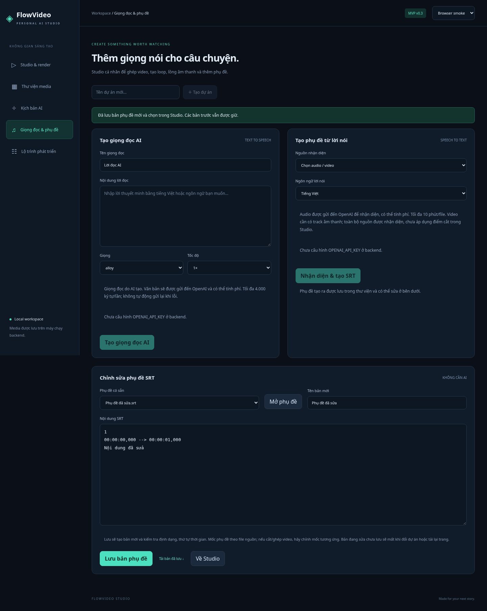

# Giọng đọc AI và phụ đề



## Cấu hình

Đặt biến môi trường trong terminal chạy backend, rồi khởi động lại backend:

```bash
export OPENAI_API_KEY='your-key'
export OPENAI_TTS_MODEL='gpt-4o-mini-tts'
dotnet run --project src/Studio.Api --urls http://127.0.0.1:5080
```

PowerShell dùng `$env:OPENAI_API_KEY = 'your-key'`. Không gửi key trong chat, không ghi vào Angular hoặc commit vào Git. `.env.example` chỉ làm mẫu, ứng dụng không tự đọc `.env`.

## Tạo giọng đọc

Chọn dự án → Giọng đọc & phụ đề → nhập tên/nội dung → chọn giọng, tốc độ → Tạo giọng đọc AI. Audio MP3 được lưu vào thư viện và chọn trong Studio. Nghe thử bằng player trước khi render. Đây là giọng tổng hợp bằng AI.

Tối đa 4.000 ký tự/request, tốc độ 0,5–1,5 (UI có preset), sáu giọng: alloy, echo, fable, onyx, nova, shimmer. Tên giọng không bảo đảm vùng giọng tiếng Việt cụ thể; cần nghe thử. Request mặc định dùng `gpt-4o-mini-tts`; model cấu hình thay thế phải hỗ trợ cùng tham số/định dạng.

## Tạo phụ đề tự động

Chọn audio hoặc video trong dự án → chọn tiếng Việt, tiếng Anh hoặc tự nhận diện → Nhận diện & tạo SRT. Dịch vụ dùng `whisper-1` với `verbose_json` để lấy timestamp theo đoạn; chưa có timestamp từng từ hay phụ đề karaoke.

Giới hạn 10 phút/file; nguồn dài hơn bị từ chối trước khi gọi AI. Video cần track audio. Audio được trích thành mono MP3 16 kHz/64 kbps rồi gửi đến OpenAI. Không có dịch phụ đề trong phiên bản này.

Phụ đề theo thời gian của **toàn bộ file nguồn**, chưa tự dịch mốc khi trim/reorder/ghép clip. Hãy chỉnh mốc trong editor để khớp timeline đầu ra. STT có thể nhận diện sai thuật ngữ hoặc khoảng im lặng; kiểm tra trước khi dùng.

## Sửa phụ đề không cần AI

Mở một SRT từ danh sách hoặc dán SRT trực tiếp. Mỗi mục gồm số thứ tự, thời gian `00:00:01,000 --> 00:00:03,000`, rồi nội dung. Các mục ngăn bằng dòng trống. Sau khi sửa, Lưu bản phụ đề tạo asset mới, chọn nó trong Studio và cho phép tải xuống. Bản cũ giữ nguyên.

Giới hạn editor: 100.000 ký tự, tối đa 5.000 mục; mỗi mục tối đa 2.000 ký tự. Mốc bắt đầu phải tăng không giảm, điểm kết thúc lớn hơn bắt đầu. Chấp nhận mục chồng thời gian. Nội dung chưa lưu mất khi đổi dự án/reload.

## Thời gian, lỗi và chi phí

Tính năng AI hiện chạy theo HTTP request, chưa có hàng đợi/resume. Provider có thời hạn 90 giây, frontend 120 giây. Không tự retry request tính phí. Nếu mất kết nối, dịch vụ bên ngoài vẫn có thể đã nhận và tính phí; kiểm tra trước khi gửi lại. Không có bảng giá hay giới hạn ngân sách tự động trong bản này.

Backend kiểm tra audio và dữ liệu timestamp trước khi lưu. Lỗi provider trả thông báo chung; không đưa key hay raw response lỗi ra giao diện. Audio/sub chỉ hiện trong thư viện sau khi lưu thành công; file tạm được dọn khi xử lý kết thúc.

## Kiểm thử

```bash
dotnet test tests/Studio.Api.Tests -c Release
```

Test dùng HTTP handler mô phỏng upstream, SQLite và FFmpeg thật. Không gọi OpenAI và không phát sinh phí. Cần thử bằng tài khoản có quyền dùng model để xác nhận chất lượng giọng đọc/nhận diện thực tế.
