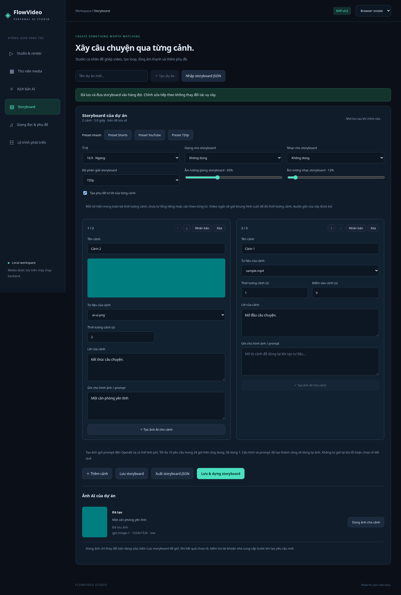

# Đợt 10 chức năng v0.6

## Thư viện: tìm, lọc và xem trước

Tìm theo tên tài nguyên; không cần nhập dấu tiếng Việt. Bộ lọc loại kết hợp với từ khóa. Xóa bộ lọc để thấy toàn bộ tài nguyên của dự án.

Bấm thumbnail/biểu tượng để mở preview. Dialog hỗ trợ ảnh, video, audio và nội dung SRT; Escape hoặc Đóng để thoát, media dừng khi đóng. Trình duyệt có thể không hỗ trợ codec của một số MOV/MKV; có thể tải file để xem bằng phần mềm khác. SRT preview tối đa 128 KiB, file lớn vẫn tải được.

## Nhân bản cảnh

Nút Nhân bản tạo cảnh ngay sau cảnh gốc, có ID mới và tên thêm “bản sao”. Tư liệu, điểm vào, thời lượng, lời và prompt được sao chép; sửa bản sao không sửa cảnh gốc. Tối đa 30 cảnh; giữ tổng thời lượng không quá 600 giây trước khi lưu/dựng.

## Xuất và nhập storyboard JSON

Xuất storyboard JSON sẽ lưu bản đang sửa trước rồi tải file package schemaVersion 1. File chứa ý tưởng, script, cảnh, thứ tự và cấu hình, không chứa media, render, lịch sử AI hoặc API key.

Nút Nhập storyboard JSON ở cạnh Tạo dự án nhận file tối đa 2 MiB. Khi đang mở dự án, ứng dụng lưu bản đang sửa trước. Nhập hợp lệ tạo **dự án mới**, giữ nguyên bản cũ. ID cảnh được tạo mới; assetId, voiceId, musicId bị bỏ và điểm vào về 0. Hãy nhập/chọn lại media và audio. Không tự sao chép file giữa dự án hoặc tự gọi AI.

JSON phải có format `flowvideo.storyboard`, schemaVersion 1, name và document hợp lệ. File không hợp lệ không tạo dự án; việc lưu bản hiện tại trước đó vẫn được giữ. Nếu bản hiện tại có lỗi hoặc xung đột phiên bản, sửa/lưu trước khi nhập.

## Tải SRT theo render

Job hoàn tất có phụ đề sẽ hiện Tải SRT. Storyboard dùng mốc sau normalize để ghi cue; file SRT ngoài được giữ nguyên như đã dùng để burn-in, không tự dịch mốc/cắt cue ngoài thời lượng video. Job không có phụ đề, đang chạy, lỗi hoặc đã hủy không cho tải SRT.

Chỉ các render mới từ v0.6 có file này; không tạo bù cho video cũ. SRT nằm cạnh MP4 trong data/exports và được dọn khi job lỗi/hủy.

## Preset và Full HD

- Shorts: 9:16, 1080×1920.
- YouTube: 16:9, 1920×1080.
- 720p: giảm độ phân giải về 720p, giữ tỉ lệ hiện tại.

Preset chỉ đổi tỉ lệ/độ phân giải, giữ lời, tư liệu, thời gian và audio. Có thể chọn 720p/1080p trực tiếp trong Studio hoặc Storyboard. 1080p tốn CPU/thời gian/dung lượng hơn; vẫn dùng H.264, AAC, 30 fps và letterbox. Không có 4K hoặc GPU auto-selection trong bản này.

## Mixer âm lượng

Giọng và nhạc chỉnh riêng từ 0–200%; 0% là mute. Mặc định giọng 100%, nhạc 18%. Limiter đỉnh 0,95 tránh quá tải khi cộng hai track, có bù trễ; không phải loudness normalization hay auto-ducking. Audio gốc của clip vẫn bị bỏ.

Mixer/độ phân giải của Storyboard được lưu cùng document, đi theo JSON export và snapshot job. Lựa chọn trong Studio độc lập với Storyboard. Job cũ không có trường mới dùng default 720p, giọng 100%, nhạc 18%.

Mười chức năng này không cần API key. Không thêm bảng hoặc thay cột database trong đợt v0.6.
