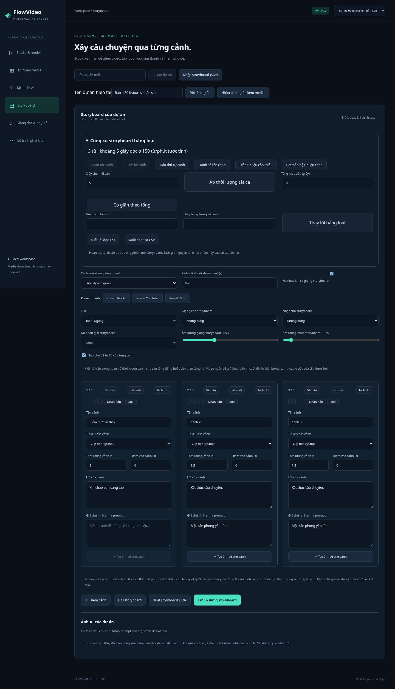

# Đợt 30 chức năng v0.7

Đợt này mở rộng công việc dựng video hằng ngày. Cả 30 chức năng dưới đây chạy không cần API key; không phát sinh lượt AI. Backend tiếp tục dùng C#/.NET 10, Angular 21, SQLite và FFmpeg/ffprobe. Không thêm dependency runtime hoặc bảng database.

## Danh sách nghiệm thu

| # | Chức năng mới | Cách dùng / kết quả |
|---|---|---|
| 1 | Đổi tên dự án | Ô Tên dự án hiện tại → Đổi tên dự án; giữ ID và dữ liệu. |
| 2 | Nhân bản toàn dự án kèm media | Lưu bản đang sửa, tạo dự án với bản sao file độc lập, ánh xạ lại cảnh/giọng/nhạc. |
| 3 | Đổi tên tài nguyên | Mở preview → Tên tài nguyên → Đổi tên; giữ phần mở rộng và file gốc. |
| 4 | Sắp xếp thư viện | Tên hoặc loại, tăng/giảm; kết hợp tìm kiếm và bộ lọc có sẵn. |
| 5 | Xem thông số media | Preview → Đọc thông số: byte, thời lượng, kích thước, codec, fps khi có. |
| 6 | Chọn media hàng loạt | Chọn từng file, chọn tối đa 20 file đang lọc hoặc bỏ chọn. |
| 7 | Tải media đã chọn thành ZIP | Tối đa 20 file / 100 MiB dữ liệu nguồn. |
| 8 | Xuất danh mục thư viện CSV | Tất cả media của dự án: ID, tên, loại, dung lượng. |
| 9 | Hoàn tác/làm lại cảnh | Lịch sử tối đa 20 thay đổi trong phiên mở storyboard. |
| 10 | Tách đôi cảnh | Chia thời lượng ở giữa; video chia điểm vào nguồn tương ứng. |
| 11 | Đảo thứ tự toàn bộ cảnh | Một thao tác; có thể hoàn tác. |
| 12 | Đưa cảnh về đầu/cuối | Nút trên mỗi cảnh. |
| 13 | Áp thời lượng cho mọi cảnh | Nhập giây/cảnh → Áp thời lượng tất cả. |
| 14 | Co giãn cảnh theo tổng thời lượng | Phân bổ theo tỷ trọng hiện tại, bước 0,1 giây và tối thiểu 0,1 giây/cảnh. |
| 15 | Đánh số lại tên cảnh | Đặt Cảnh 1, Cảnh 2… theo thứ tự hiện tại; có thể hoàn tác. |
| 16 | Tìm/thay lời trên mọi cảnh | Thay chuỗi chính xác, phân biệt hoa thường; không dùng regex. |
| 17 | Gỡ toàn bộ tư liệu cảnh | Bỏ liên kết media và đưa điểm vào về 0; có thể hoàn tác. |
| 18 | Điền tư liệu cho cảnh trống | Luân phiên ảnh/video từ thư viện; giữ liên kết đã có. |
| 19 | Đếm từ và ước lượng thời gian đọc | Tách từ theo khoảng trắng, ước lượng 150 từ/phút. |
| 20 | Xuất lời đọc TXT | Lưu bản đang sửa rồi xuất lời các cảnh theo thứ tự. |
| 21 | Xuất shotlist CSV | Thứ tự, tiêu đề, thời điểm bắt đầu trên storyboard, thời lượng, lời, prompt, tên media. |
| 22 | Dịch mốc SRT | Cộng/trừ số giây cho tất cả câu, không cho kết quả âm. |
| 23 | Co giãn mốc SRT theo tốc độ | Tốc độ 0,25–4×, chia thời điểm bắt đầu/kết thúc theo hệ số. |
| 24 | Tìm/thay chữ trong SRT | Thay chuỗi chính xác trong lời, giữ các mốc thời gian. |
| 25 | Tự ngắt dòng SRT | 20–80 ký tự/dòng; hỗ trợ tiếng Việt và từ dài. |
| 26 | Gộp câu SRT gần nhau | Khoảng nghỉ 0–5 giây; không gộp câu chồng lấn, tổng câu gộp tối đa 10 giây. |
| 27 | Xuất WebVTT | Xuất từ bản SRT đang sửa, timestamp dùng dấu chấm, escape markup. |
| 28 | Chọn cách vừa khung | Contain giữ trọn hình có viền; cover phóng và cắt giữa cho đầy khung. |
| 29 | Fade đầu/cuối video và audio | 0–2 giây; tự giới hạn không quá nửa video; không phải crossfade giữa cảnh. |
| 30 | Tự hạ nhạc dưới giọng | Sidechain compressor khi có cả giọng và nhạc; nhạc phục hồi khi giọng yên lặng. |

## Nhân bản, media và xuất file

Nhân bản dự án tối đa 200 tài nguyên và 500 MiB tổng file. Tác vụ tạo GUID mới cho dự án/cảnh/media, sao chép file nguồn, giữ cấu hình storyboard và đặt document version 1. Không sao chép video đã xuất, job render hay lịch sử AI. File thiếu sẽ chặn nhân bản; nếu thao tác thất bại, file đã copy được dọn. Nếu không lưu được storyboard hiện tại (dữ liệu sai hoặc xung đột phiên bản), sửa trước khi nhân bản.

ZIP chỉ nhận tài nguyên thuộc đúng dự án, không nhận ID trùng. Tên entry có tiền tố thứ tự, bỏ đường dẫn và dấu hai chấm; dữ liệu được đóng gói trong file tạm rồi xóa sau response. CSV dùng UTF-8 BOM và quote/escape ô, thêm apostrophe cho ô có thể bị bảng tính hiểu thành công thức. CSV thư viện chứa toàn bộ dự án, không chỉ các file đang lọc/chọn.

Metadata chạy ffprobe tối đa 15 giây; file không hợp lệ trả lỗi thay vì trả thông số giả. Một số định dạng thiếu duration/codec/fps; chỉ hiện trường có dữ liệu. Phụ đề chỉ có dung lượng và loại SRT. Đổi tên chỉ thay tên hiển thị, không đổi file vật lý.

## Thao tác storyboard

Hoàn tác/làm lại chỉ bao gồm danh sách cảnh: thêm/xóa, sửa nội dung, sắp xếp, chọn media, nhân bản, tách và thao tác hàng loạt. Lưu không xóa lịch sử, nhưng chuyển tab, đổi dự án hoặc reload sẽ kết thúc phiên lịch sử. Các input văn bản/số cập nhật ngay khi gõ, gộp thay đổi trong một lần focus thành một bước lịch sử thay vì mỗi ký tự. Cấu hình dựng và dữ liệu AI không nằm trong lịch sử này.

Tách cần cảnh ít nhất 0,2 giây và tổng số cảnh dưới 30. Hai phần giữ cùng lời và prompt để người dùng biên tập lại. Với video, nếu điểm giữa nằm trong đoạn giữ khung cuối do nguồn ngắn, ứng dụng báo lỗi và giữ cảnh gốc. Điền media chỉ dùng tư liệu đã nhập, theo thứ tự thư viện của dự án, không tự tìm tư liệu hoặc gửi yêu cầu AI.

Co giãn tổng dùng bước 0,1 giây, tổng mục tiêu được làm tròn tới bước này. Vẫn áp dụng giới hạn 30 cảnh, 600 giây và độ dài lời tối đa 2.000 ký tự/cảnh. Đếm “từ” tiếng Việt thực tế gần với số đơn vị cách nhau bởi khoảng trắng, chỉ dùng ước lượng; không phải thời lượng TTS.

## Phụ đề và dựng

Công cụ SRT sửa bản nháp sau khi xác thực toàn bộ kết quả; lỗi giữ nguyên bản nháp trước đó. Bấm **Lưu bản phụ đề** để tạo asset mới; file trước đó không đổi. Có thể nối nhiều phép biến đổi trước khi lưu. Xuất WebVTT lấy bản nháp hiện tại, chưa hỗ trợ nhập WebVTT hoặc burn-in WebVTT trực tiếp.

Contain/cover áp dụng trong bước normalize. Fade diễn ra ở đầu/cuối toàn bản xuất, gồm phụ đề burn-in và audio nếu có. Bật fade sẽ encode lại video ở bước cuối. Duck chỉ hoạt động khi có cả voiceId và musicId, dùng mức giọng sau gain để điều khiển compressor; không tự nhận diện lời nói và không đọc lời cảnh thành giọng. Gain giọng bằng 0 sẽ không kích hoạt duck. Audio gốc clip tiếp tục bị bỏ.

Cấu hình fit/fade/duck của storyboard đi theo lưu, JSON, nhân bản và snapshot render; tùy chọn Studio độc lập. Document/job cũ mặc định contain, không fade và không duck nên giữ hành vi cũ.

## Kiểm chứng

- 47 kiểm thử .NET gồm hợp đồng AI mô phỏng, dữ liệu, render, clone độc lập, metadata, ZIP và CSV.
- 7 kiểm thử Node cho phân bổ thời lượng, SRT và WebVTT, chạy `npm run test:tools` trong `src/Studio.Web`.
- Smoke FFmpeg kiểm tra pixel contain/cover/fade, RMS audio fade/duck và thời lượng loop, cùng các luồng render/cancel/trim cũ.
- Playwright kiểm tra UI, tải TXT/CSV/ZIP/VTT, lịch sử cảnh, tách, sửa hàng loạt, clone, metadata, cấu hình lưu và layout mobile.

Sinh video AI, timeline nhiều track, loop liền mạch và đăng mạng xã hội vẫn thuộc roadmap, chưa có trong v0.7.
