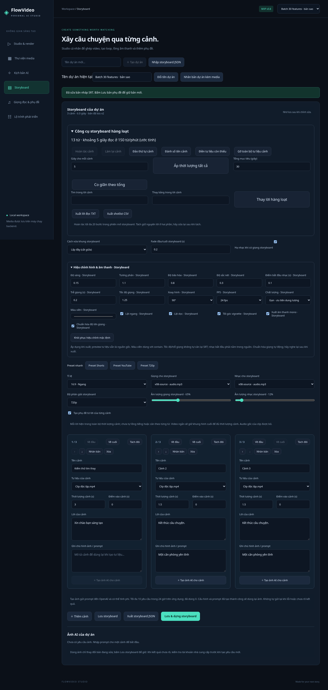

# Đợt 30 chức năng v0.8

Đây là **30 chức năng mới so với v0.7**, tập trung vào chất lượng bản dựng, tái sử dụng tư liệu và biên tập phụ đề. Không cần API key, không gọi AI hay cài thêm dependency runtime. Stack giữ nguyên C#/.NET 10, Angular 21 và FFmpeg/ffprobe.

## Danh sách nghiệm thu

| # | Chức năng mới | Cách dùng |
|---|---|---|
| 1 | Chỉnh độ sáng video | Hiệu chỉnh hình & âm thanh → Độ sáng, từ -0,5 đến 0,5. |
| 2 | Chỉnh tương phản video | Hệ số 0,5–2; mặc định 1. |
| 3 | Chỉnh độ bão hòa màu | Hệ số 0–2; 0 tạo hình xám, mặc định 1. |
| 4 | Lật ngang hình | Áp dụng cho mọi cảnh của bản xuất. |
| 5 | Lật dọc hình | Áp dụng cho mọi cảnh của bản xuất. |
| 6 | Xoay hình | Chọn 0/90/180/270 độ trước khi vừa khung. |
| 7 | Hiệu ứng tối góc vignette | Bật để làm tối vùng rìa hình. |
| 8 | Tăng độ sắc nét | Hệ số unsharp 0–1,5; 0 giữ nguyên. |
| 9 | Chọn màu viền video | Color picker; dùng với contain, mặc định đen. |
| 10 | Chọn tốc độ khung hình đầu ra | 24, 30 hoặc 60 fps; mặc định 30. |
| 11 | Chọn mức chất lượng/dung lượng | Gọn, Chuẩn, Cao tương ứng CRF 28/23/18. |
| 12 | Xuất âm thanh mono | Gộp audio sau mix xuống một kênh. |
| 13 | Chọn điểm bắt đầu nhạc nền | Bắt đầu trong file nhạc tại mốc đã chọn; vẫn lặp nhạc. |
| 14 | Chèn độ trễ giọng đọc | Thêm 0–60 giây im lặng trước giọng. |
| 15 | Đổi tốc độ giọng đọc | 0,75–1,5×, giữ cao độ bằng atempo. |
| 16 | Chuẩn hóa độ lớn giọng | Loudnorm một lượt, mục tiêu -16 LUFS, trước gain/trễ và mixer. |
| 17 | Tạo/tải thumbnail PNG | Preview ảnh/video → Tạo thumbnail PNG; video dùng mốc đã chọn. |
| 18 | Xem/tải ảnh sóng âm | Preview audio/video có âm thanh → Xem sóng âm. |
| 19 | Tách audio video vào thư viện | Preview video → Tách audio; tạo MP3 độc lập cùng dự án. |
| 20 | Lưu khung hình video vào thư viện | Chọn mốc rồi lưu thành PNG độc lập, có thể gán cho cảnh. |
| 21 | Xóa định dạng phụ đề | Xóa thẻ HTML và khối định dạng ASS trong lời SRT. |
| 22 | Gộp lời trùng liên tiếp | Gộp cùng lời nếu gần nhau/chồng lấn, tránh hiển thị lặp. |
| 23 | Phân tích tốc độ đọc phụ đề | Thống kê số câu, thời điểm kết thúc, chồng lấn và câu vượt 20 ký tự/giây. |
| 24 | Xuất lời SRT ra TXT | Xuất lời của bản nháp, bỏ định dạng và mốc thời gian. |
| 25 | Tách câu phụ đề dài | Giới hạn 20–200 ký tự/câu, chia đều khoảng thời gian của câu gốc. |
| 26 | Cắt SRT theo thời lượng đích | Xóa câu bắt đầu ngoài khoảng; cắt điểm kết thúc câu cuối. |
| 27 | Lọc hàng đợi theo trạng thái | Tất cả, chờ, đang xử lý, hoàn tất, lỗi hoặc đã hủy. |
| 28 | Đổi thứ tự hiển thị hàng đợi | Mới trước/Cũ trước; không thay thứ tự worker chạy. |
| 29 | Tải cấu hình của từng bản dựng | Link Cấu hình JSON trong job, chứa snapshot thực tế của request. |
| 30 | Tải audio của video đã xuất | Job hoàn tất có audio → Tải audio MP3. |

## Hiệu chỉnh hình và âm thanh

Mở khối **Hiệu chỉnh hình & âm thanh** trong Studio hoặc Storyboard. Tùy chỉnh của hai màn hình độc lập. Storyboard lưu `effects` cùng document; cấu hình đi theo JSON export/import, nhân bản dự án và snapshot job. Studio dùng cấu hình cho request đang tạo. Không tự áp dụng lên media gốc hoặc preview nguồn. Nút khôi phục đưa riêng nhóm hiệu chỉnh về mặc định.

Thứ tự hình: xoay → lật → màu sắc → scale/crop/pad → fps → sharpen → vignette. Cover không có vùng viền nên màu viền không tác dụng. Vignette có thể làm tối cả phần viền. Phụ đề và fade tiếp tục được áp dụng ở bước xuất cuối. Chọn 60 fps không tạo thêm chuyển động AI; FFmpeg lặp/bỏ frame theo nguồn. Chất lượng cao có thể tăng dung lượng/thời gian encode, không khôi phục chi tiết đã mất trong nguồn.

Giọng: đổi tốc độ → chuẩn hóa nếu bật → gain → trễ → pad → mix/duck/limiter/fade hiện có. Chuẩn hóa dùng loudnorm một lượt; không bảo đảm đo chính xác -16 LUFS sau khi người dùng đổi gain/mix, vẫn nên nghe lại. Khi bật chuẩn hóa giọng, audio đầu ra dùng 48 kHz. Mono áp dụng sau mixer, trước limiter để giới hạn đỉnh sau khi gộp kênh. Không tự nhận diện lời nói hoặc tự sửa mốc phụ đề theo tốc độ/trễ giọng; người dùng chỉnh SRT riêng.

Điểm bắt đầu nhạc 0–600 giây phải nhỏ hơn thời lượng nguồn thực tế; nếu vượt nguồn, job báo lỗi và được dọn đầu ra. Tùy chọn giọng/nhạc chỉ tác dụng khi có track tương ứng. Audio gốc của clip vẫn bị bỏ khi dựng; có thể tách audio thành asset bằng chức năng #19 rồi chọn làm giọng/nhạc.

Document và job cũ không có `effects` tiếp tục dùng hình/âm thanh như v0.7: không chỉnh màu/lật/xoay, viền đen, 30 fps, CRF 23 và không đổi giọng. Không thay bảng/cột SQLite.

## Công cụ tư liệu

Mở preview từ thư viện. Thumbnail, ảnh khung hình được resize vừa trong **640×640**, giữ tỉ lệ nguồn; không phải ảnh chụp nguyên độ phân giải. Thumbnail chỉ để xem/tải; Lưu khung hình tạo asset PNG mới. Với ảnh tĩnh, mốc lấy ảnh không ảnh hưởng kết quả.

Sóng âm gộp track audio đầu tiên thành mono để vẽ PNG **1000×200**. Đây là ảnh tham khảo biên độ, không phải editor waveform tương tác. Nguồn không có audio trả lỗi rõ ràng. Tách audio tạo MP3 stereo, 48 kHz, 128 kbps. Tải audio bản xuất cũng dùng định dạng này; không thay file MP4 hoặc thêm asset vào thư viện.

Giới hạn nguồn tối đa 10 phút, tối đa hai công cụ media đồng thời, mỗi tác vụ chờ tối đa 60 giây. Công cụ chạy theo request, không có journal/resume; nếu mất kết nối, kiểm tra thư viện trước khi tạo lại asset. File tạm/lỗi được dọn. File kết quả độc lập với nguồn; thumbnail/sóng âm không làm tăng số asset, ảnh khung và audio đã tách thì có.

## Công cụ SRT

Tất cả xử lý trên bản nháp; bấm **Lưu bản phụ đề** để tạo asset mới. Không sửa file cũ. Kết quả phải qua parser trước khi thay bản nháp, nên lỗi không làm mất nội dung đang sửa.

- Xóa định dạng loại thẻ `<...>` và khối `{\...}`. Nếu một câu trở thành rỗng, thao tác bị từ chối để người dùng xử lý thủ công.
- Gộp lời trùng so sánh sau khi gom khoảng trắng, vẫn phân biệt hoa/thường. Chỉ gộp câu liên tiếp có khoảng cách tối đa 250 ms hoặc chồng lấn, tổng khoảng thời gian gộp tối đa 10 giây; giữ lời câu đầu.
- Phân tích tính ký tự Unicode không tính khoảng trắng, ngưỡng 20 ký tự/giây; hiện tối đa 20 số câu cần xem lại. Đây là báo cáo tại thời điểm bấm, không phải kiểm chứng tốc độ TTS.
- TXT lấy lời từ bản nháp, xóa định dạng như trên, giữ thứ tự. Không phải lời storyboard.
- Tách câu dài bỏ định dạng trước để tránh thẻ bị cắt dở, giữ toàn bộ chữ, phân chia theo từ, chia cả từ dài nếu cần; thời gian mỗi phần bằng nhau tới mili giây. Không đồng bộ theo âm thanh; mốc quá ngắn để chia bị từ chối.
- Cắt theo tổng 0,1–600 giây tính từ đầu SRT, không dịch câu về 0. Nếu không còn câu trong khoảng đích, giữ nguyên bản nháp và báo lỗi.

## Hàng đợi và bản xuất

Lọc/sắp xếp chỉ ảnh hưởng 100 job gần nhất đã tải; worker tiếp tục FIFO và polling vẫn theo tất cả job. Không ưu tiên hoặc hủy job khi đổi bộ lọc.

Recipe JSON có format `flowvideo.render-recipe`, schemaVersion 1, ID job/project, trạng thái tại thời điểm tải và RenderRequest snapshot. File không chứa API key, đường dẫn vật lý hoặc nội dung media. ID asset chỉ có ý nghĩa trong workspace hiện tại; chưa có import/chạy lại recipe từ file này. Link audio chỉ hiện khi request có giọng hoặc nhạc; API vẫn kiểm tra job hoàn tất, file tồn tại và có track audio thực tế.

## Kiểm chứng

- 53 kiểm thử .NET: toàn bộ kiểm thử trước đó và 6 bài integration mới cho hiệu chỉnh, tương thích JSON, dẫn xuất media, lỗi đầu vào, recipe và MP3 thật.
- 12 kiểm thử Node cho tiện ích thời lượng/SRT/WebVTT, gồm năm bài mới cho công cụ SRT v0.8.
- FFmpeg smoke đo pixel màu/viền/xoay/lật, fps, mono và RMS theo thời gian để kiểm tra trễ/tốc độ giọng, cùng các kiểm tra render/fade/duck/cancel đã có.
- Playwright kiểm tra 16 tùy chọn lưu/snapshot, thumbnail/sóng âm/khung hình/tách audio, 6 công cụ SRT, lọc/sort job, tải recipe và MP3, desktop/mobile.

Sinh video AI, timeline nhiều track, loop liền mạch và đăng mạng xã hội vẫn thuộc roadmap; v0.8 không giả lập các kết quả này.
