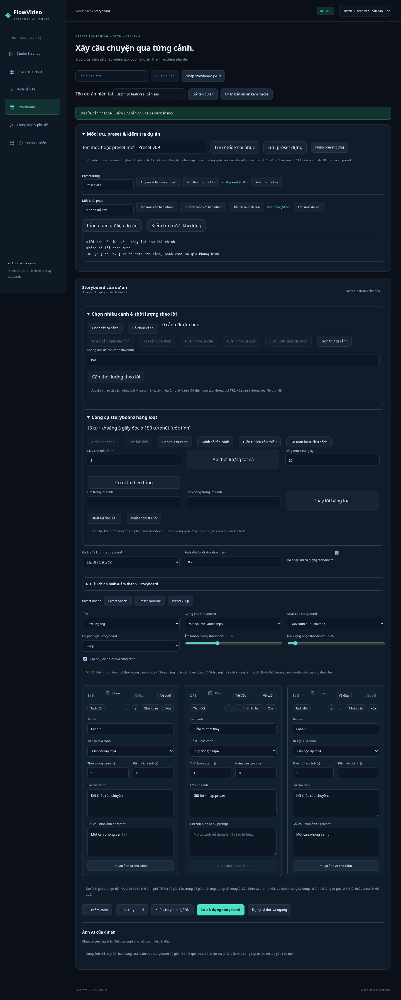

# Đợt 30 chức năng v0.9

Đợt này bổ sung **30 chức năng mới so với v0.8**, tập trung vào lưu/khôi phục công việc, tái sử dụng cấu hình và thao tác hàng loạt. Không cần API key và không phát sinh lượt AI. Backend vẫn là C#/.NET 10, frontend Angular 21, dữ liệu SQLite, dựng bằng FFmpeg.

## Danh sách nghiệm thu

| # | Chức năng mới | Cách dùng / kết quả |
|---|---|---|
| 1 | Lưu và xem danh sách mốc khôi phục | Đặt tên → Lưu mốc khôi phục; chụp document đã lưu vào SQLite. |
| 2 | Khôi phục mốc vào bản nháp | Mở mốc vào bản nháp; giữ phiên bản hiện tại để lưu bằng optimistic concurrency. |
| 3 | So sánh mốc với bản nháp | Báo số cảnh thêm/bỏ/sửa, thay đổi danh sách/thứ tự và các trường cấu hình. |
| 4 | Xuất mốc thành storyboard JSON | Tải đúng nội dung của mốc, dùng được với luồng nhập storyboard hiện có. |
| 5 | Đổi tên mốc khôi phục | Chỉnh tên mục → Đổi tên mục đã lưu. |
| 6 | Xóa mốc khôi phục | Có xác nhận; không xóa document hiện tại hoặc media. |
| 7 | Lưu và xem preset dựng cá nhân | Lưu các tùy chỉnh dựng vào SQLite, không kèm lời/cảnh/liên kết media. |
| 8 | Áp preset dựng | Đổi cấu hình storyboard, giữ cảnh, ý tưởng/script và audio đang chọn. |
| 9 | Đổi tên preset dựng | Đổi tên preset đã lưu trong dự án. |
| 10 | Xóa preset dựng | Có xác nhận; không thay cấu hình đang dùng. |
| 11 | Mang preset qua JSON | Xuất/nhập package preset giữa các dự án/workspace. |
| 12 | Tổng quan dữ liệu dự án | Số asset, byte nguồn, file thiếu, cảnh/thời lượng, phiên bản, số mốc/preset và trạng thái mọi job. |
| 13 | Kiểm tra trước khi dựng | Kiểm tra metadata/file, điểm vào, phần giữ khung cuối, audio và cảnh thiếu tư liệu/lời. |
| 14 | Căn thời lượng cảnh theo lời | Ước lượng theo tốc độ 60–300 từ/phút, áp vào toàn bộ cảnh. |
| 15 | Trộn thứ tự cảnh | Fisher–Yates trên bản sao danh sách; có hoàn tác. |
| 16 | Chọn nhiều cảnh | Checkbox từng cảnh, chọn tất cả hoặc bỏ chọn. |
| 17 | Nhân bản nhóm cảnh đã chọn | Chèn bản sao ngay sau từng cảnh gốc với ID mới. |
| 18 | Xóa nhóm cảnh đã chọn | Bỏ cảnh khỏi bản nháp; có thể hoàn tác, không xóa file. |
| 19 | Di chuyển nhóm về đầu/cuối | Giữ thứ tự nội bộ nhóm và thứ tự các cảnh còn lại. |
| 20 | Xuất JSON chỉ các cảnh đã chọn | Tạo package storyboard có cấu hình hiện tại và tập cảnh được chọn. |
| 21 | Sắp lại câu SRT theo thời gian | Chấp nhận câu chưa đúng thứ tự, sắp ổn định theo mốc bắt đầu rồi đánh số lại. |
| 22 | Xử lý mốc SRT chồng lấn | Dời câu sau tới sau câu trước, giữ mọi lời và thời lượng dương. |
| 23 | Giãn câu SRT quá ngắn | Áp thời lượng tối thiểu 0,1–10 giây, đẩy các câu sau nếu cần. |
| 24 | Chuẩn hóa khoảng trắng SRT | Trim từng dòng, gom space/tab, chuẩn hóa Unicode NFC. |
| 25 | Đổi chữ hoa/thường SRT | Chọn chữ hoa hoặc chữ thường tiếng Việt, giữ thẻ định dạng. |
| 26 | Xem bảng timeline SRT | Hiện số câu, mốc vào/ra và lời dưới dạng bảng để rà soát. |
| 27 | Dựng hai tỉ lệ một lượt | Tạo hai job 9:16 và 16:9 từ cùng một snapshot storyboard. |
| 28 | Dựng lại job đã hoàn tất | Tạo job mới từ request snapshot gốc, giữ job cũ. |
| 29 | Thống kê nhanh hàng đợi | Đếm chờ/đang xử lý/hoàn tất/lỗi/hủy trong 100 job gần nhất. |
| 30 | Tìm tác vụ render | Tìm theo ID, thông báo hoặc tên trạng thái; kết hợp bộ lọc/sắp xếp. |

## Mốc khôi phục và preset

Trong Storyboard, mở **Mốc lưu, preset & kiểm tra dự án**. Lưu mốc/preset sẽ lưu bản nháp hiện tại trước, rồi chụp đúng version đó. Khi có xung đột phiên bản hoặc document không hợp lệ, thao tác bị từ chối thay vì tự ghi đè.

Mỗi dự án tối đa **20 mốc và 20 preset**. Tên từ 1–120 ký tự, không chứa ký tự điều khiển. Mốc giữ idea, script, cảnh, ID tham chiếu media/audio và các tùy chọn dựng. Đây là bản chụp document, **không sao chép file media hoặc video đã xuất**. Nếu nguồn bị xóa ngoài ứng dụng, mốc vẫn tồn tại nhưng cần bổ sung file/chọn lại tư liệu trước khi dựng.

Mở mốc thay thế bản nháp hiện tại; hãy lưu nội dung cần giữ thành mốc riêng trước. Document đã lưu chưa đổi cho đến khi bấm Lưu storyboard hoặc một thao tác có lưu trước. Sau khi mở mốc, version của dự án giữ nguyên version hiện tại, không quay ngược số phiên bản. Lịch sử hoàn tác của editor được mở thành phiên mới. So sánh báo khác biệt cấu trúc document, không so hình ảnh/audio đã render; nó không sửa dữ liệu.

Preset chỉ giữ ratio, autoCaptions, resolution, gain, fit, fade, duck và nhóm effects. Khi áp dụng, cảnh, idea/script, voiceId và musicId hiện tại được giữ nguyên. Đổi tên/xóa mục không thay nội dung bản chụp; xóa cần xác nhận và không có thùng rác. Cấu hình đã áp dụng vẫn nằm trong bản nháp ngay cả khi xóa preset.

Mốc xuất dạng `flowvideo.storyboard` schemaVersion 1, nhập được bằng nút Nhập storyboard JSON hiện có. Nhập theo cách đó tạo dự án mới và bỏ liên kết media như trước. Preset dùng `flowvideo.render-preset` schemaVersion 1, tối đa **64 KiB**; import kiểm tra cả body có/không có Content-Length, xóa mọi cảnh/idea/script/liên kết media và chỉ lưu cấu hình hợp lệ. Import không tự áp preset.

Các mốc/preset nằm trong bảng SQLite mới `SavedWorkspaceItems`; upgrade dùng CREATE TABLE/INDEX IF NOT EXISTS, không viết lại bảng cũ. Nhân bản dự án hiện có tiếp tục sao chép document/media; không sao chép danh sách mốc/preset. Có thể dùng JSON để mang preset qua dự án khác. Sao lưu toàn bộ data khi backend dừng vẫn là cách giữ cả file nguồn.

## Tổng quan và kiểm tra trước khi dựng

Tổng quan đọc **bản document đã lưu**, mọi asset và mọi job của dự án. Dung lượng chỉ là tổng byte của file asset còn tồn tại, không bao gồm MP4/SRT đã xuất, file tạm hay database; không phải báo cáo toàn bộ dung lượng ổ đĩa.

Kiểm tra trước khi dựng lưu bản nháp trước, dùng ffprobe để kiểm tra file/metadata của tư liệu và audio. Nó báo lỗi khi chưa có cảnh, cảnh thiếu binding/file, không đọc được metadata, điểm vào ngoài nguồn hoặc musicStart nằm ngoài nhạc. Cảnh dùng video ngắn hơn duration được cảnh báo vì renderer sẽ giữ khung cuối. Các cảnh thiếu lời phụ đề, lời chưa có giọng hoặc giọng dài hơn bản dựng được nhắc để kiểm tra.

Tối đa hai preflight đồng thời, timeout tổng 30 giây; nguồn trùng được dùng lại metadata trong một lần kiểm tra. Đây là kiểm tra metadata và cấu hình, không decode toàn bộ video, không bảo đảm mọi frame đều tốt và không khóa file nguồn sau kiểm tra. Không tự xếp hàng dựng hoặc gọi AI. Báo cáo đúng tại thời điểm kiểm tra, cần chạy lại sau khi chỉnh nội dung/nguồn.

## Thao tác nhiều cảnh

Mở **Chọn nhiều cảnh & thời lượng theo lời**. Tập chọn theo ID cảnh trong phiên editor hiện tại. Nhân bản giới hạn tổng 30 cảnh, tạo ID mới và giữ tư liệu/điểm vào/lời/prompt/duration. Xóa chỉ thay danh sách cảnh, không chạm vào asset. Các thao tác thay cảnh đi qua lịch sử hoàn tác hiện có; chuyển tab, đổi dự án hoặc mở mốc/preset bắt đầu phiên editor mới.

Di chuyển nhóm không đảo thứ tự nội bộ. JSON chọn cảnh giữ thứ tự hiện tại, không kèm file, dùng định dạng storyboard đã có; xuất sẽ lưu document hiện tại trước, rồi chỉ đưa các cảnh chọn vào package. Script/idea và các tùy chọn vẫn là của dự án hiện tại. Import tạo dự án mới, bỏ liên kết media theo quy tắc cũ.

Căn thời lượng tính `số từ / tốc độ đọc × 60`, làm tròn 0,1 giây, tối thiểu 0,1 giây/cảnh. Đơn vị “từ” là chuỗi cách nhau bằng khoảng trắng, gần với âm tiết với nhiều câu tiếng Việt. Cảnh không lời thành 0,1 giây; không tự giữ duration cũ. Tổng vượt 600 giây bị từ chối. Không gọi TTS hay căn theo waveform; có thể hoàn tác và chỉnh tay.

## Phụ đề

Các công cụ tiếp tục sửa bản nháp, không sửa asset cũ; cần bấm **Lưu bản phụ đề** để tạo bản mới. Kết quả phải qua parser trước khi thay nội dung.

Sắp thứ tự cho phép thứ tự start chưa đúng nhưng vẫn yêu cầu timestamp, index và lời hợp lệ; các câu có cùng start giữ thứ tự tương đối. Xử lý chồng lấn dời start câu sau tới end câu trước; nếu end cũ không còn sau start mới, thêm ít nhất 1 ms để giữ câu. Dùng tiếp công cụ giãn câu nếu cần thời lượng đọc dài hơn.

Giãn câu lấy mức tối thiểu 0,1–10 giây, tăng end và đẩy start/end các câu sau để không chồng lấn. Hai thao tác này có thể kéo dài tổng SRT, không tự đồng bộ lời với audio hoặc giới hạn vào video. Kiểm tra bảng timeline, dùng công cụ cắt theo thời lượng nếu cần.

Chuẩn hóa whitespace giữ xuống dòng nhưng gom space/tab và NFC. Đổi hoa/thường dùng locale tiếng Việt, giữ nguyên các thẻ `<...>`/khối `{\...}`. Bảng timeline là bản chụp lúc bấm, hiển thị tối đa 200 câu đầu để giới hạn DOM; không kéo thả/chỉnh mốc trực tiếp trong bảng.

## Dựng biến thể và hàng đợi

**Dựng cả dọc và ngang** lưu storyboard một lần, kiểm tra version, tạo hai job trong cùng transaction. Hai job dùng cùng scenes/audio/effects, chỉ khác ratio; mỗi job có ID/đầu ra riêng. Worker tiếp tục chạy tuần tự, không encode song song. Thay bản nháp sau đó không đổi snapshot của các job đã tạo. Tùy nguồn, contain/cover có thể tạo kết quả cần biên tập lại cho mỗi tỉ lệ.

**Dựng lại bản hoàn tất** chỉ nhận job Succeeded, sao chép request snapshot thành job mới, không lấy cấu hình bản nháp hiện tại và không gọi lại AI. Nếu file nguồn bị mất/hỏng về sau, job mới vẫn có thể lỗi. Job gốc và file xuất cũ giữ nguyên. Các intake mới từ chối khi dự án có quá nhiều job chờ/đang chạy; không thay chính sách của endpoint Studio cũ.

Thống kê và tìm kiếm trên giao diện dùng 100 job gần nhất; tổng quan dữ liệu dự án mới đếm mọi job. Tìm không phân biệt hoa/thường, giữ dấu tiếng Việt. Nó chỉ lọc hiển thị, không đổi FIFO hoặc tần suất polling theo toàn danh sách.

## Kiểm chứng

- **59 test .NET**: có 6 integration tests mới cho mốc bất biến/version/scope/khôi phục/xuất, preset/giới hạn body, giới hạn mục/upgrade cộng dồn, summary/preflight, hai tỉ lệ FFmpeg thật và dựng lại snapshot.
- **17 test Node**: có 5 bài mới cho SRT sort/overlap/minimum/whitespace/case, thời lượng đọc/shuffle và so sánh mốc.
- Media smoke cũ tiếp tục kiểm tra render, trim, loop, fade/duck/effects, hủy job, lỗi và restart.
- Playwright chạy toàn luồng mốc/preset, nhập/xuất/xóa xác nhận, nhóm cảnh, preflight, hai render thật, dựng lại, thống kê/tìm job, các công cụ SRT và layout desktop/mobile.

Sinh video AI, timeline nhiều track, loop liền mạch và đăng mạng xã hội vẫn chưa được triển khai trong v0.9.
