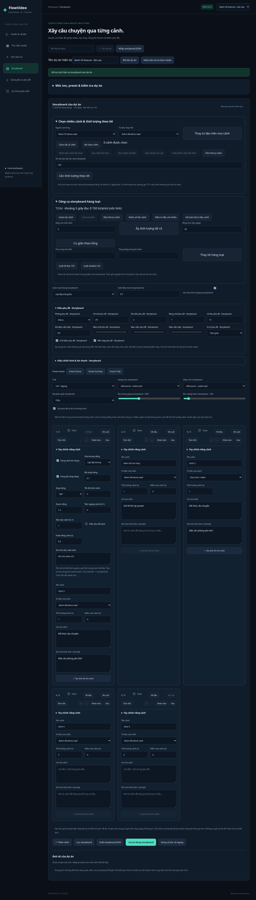

# Đợt 30 chức năng v0.10

Đợt này thêm **10 tùy chỉnh riêng từng cảnh, 10 tùy chỉnh phụ đề và 10 công cụ thư viện**, không trùng danh sách v0.9. C#/.NET 10 + Angular 21 + SQLite + FFmpeg được giữ nguyên. Không cần API key hoặc dependency runtime mới.

## Danh sách nghiệm thu

| # | Chức năng mới | Cách dùng / kết quả |
|---|---|---|
| 1 | Bật/tắt cảnh khi dựng | Tắt Dùng cảnh khi dựng để giữ cảnh trong document nhưng bỏ khỏi snapshot render. |
| 2 | Cách vừa khung riêng từng cảnh | Theo dự án, contain hoặc cover. |
| 3 | Độ sáng riêng từng cảnh | Bật override rồi chọn -0,5–0,5; tắt để theo dự án. |
| 4 | Góc xoay riêng từng cảnh | Theo dự án hoặc 0/90/180/270 độ. |
| 5 | Tốc độ hình nguồn của cảnh | Video 0,5–2×; giữ duration cảnh, bỏ audio gốc như trước. |
| 6 | Zoom riêng từng cảnh | Phóng/cắt tĩnh 1–2×; không phải zoom động. |
| 7 | Tâm khung riêng từng cảnh | Điều chỉnh X/Y từ 0–1 cho vùng crop khi cover/zoom. |
| 8 | Bật/tắt phụ đề của riêng cảnh | Bỏ cue auto-caption của cảnh mà không xóa narration. |
| 9 | Fade đầu/cuối riêng từng cảnh | 0–1 giây, không vượt nửa thời lượng cảnh. |
| 10 | Ghi chú sản xuất từng cảnh | Tối đa 1.000 ký tự, lưu cùng cảnh, không in vào video. |
| 11 | Chọn phông phụ đề | Sans, Serif hoặc Mono dựa trên DejaVu. |
| 12 | Cỡ chữ phụ đề | 12–48 đơn vị style ASS. |
| 13 | Màu chữ phụ đề | Color picker RGB. |
| 14 | Màu viền chữ phụ đề | Color picker RGB; áp dụng khi không dùng nền hộp. |
| 15 | Độ dày viền phụ đề | 0–4; cũng là khoảng đệm khi dùng hộp. |
| 16 | Bóng chữ phụ đề | 0–4. |
| 17 | Chữ đậm phụ đề | Bật/tắt bold. |
| 18 | Vị trí phụ đề | Chọn một trong 9 vị trí trên/giữa/dưới × trái/giữa/phải. |
| 19 | Lề dọc phụ đề | 0–200 đơn vị style. |
| 20 | Nền hộp phụ đề | Bật/tắt, chọn màu và độ đậm 0–100%. |
| 21 | Sao chép media qua dự án | Chọn tối đa 20 file rồi copy sang dự án khác, tạo file/ID độc lập và giữ metadata. |
| 22 | Tìm file trùng byte | SHA-256 trong nhóm file được chọn; chỉ báo cáo, không xóa file. |
| 23 | Xem nơi dùng tư liệu | Cảnh trong document đã lưu, mốc checkpoint và job tham chiếu. |
| 24 | Đổi tên media hàng loạt | Tiền tố + số thứ tự + hậu tố, giữ phần mở rộng và byte file. |
| 25 | Tạo cảnh từ media được chọn | Thêm mỗi ảnh/video được chọn thành cảnh mới 5 giây. |
| 26 | Thay tư liệu trên mọi cảnh | Đổi toàn bộ liên kết nguồn A sang B, giữ nội dung và đưa start về 0. |
| 27 | Đánh dấu media yêu thích | Nút sao trong thư viện hoặc checkbox trong preview; lưu SQLite. |
| 28 | Gắn nhãn media | Tối đa 10 nhãn, mỗi nhãn 1–30 ký tự; lưu SQLite. |
| 29 | Ghi chú media | Tối đa 1.000 ký tự; lưu riêng theo asset. |
| 30 | Lọc thư viện theo metadata | Kết hợp yêu thích/nhãn với tìm tên, loại và sắp xếp đang có. |

## Tùy chỉnh riêng từng cảnh

Trong Storyboard, mở **Tùy chỉnh riêng cảnh** trên từng thẻ. Cảnh tắt vẫn được lưu, xuất JSON, nhân bản và đưa vào checkpoint; snapshot render và hai biến thể chỉ chứa cảnh bật. Cần ít nhất một cảnh bật và tất cả cảnh bật phải có tư liệu. Giới hạn lưu vẫn là 30 cảnh, tổng duration của cả cảnh bật/tắt không quá 600 giây.

Bật/tắt cue chỉ ảnh hưởng phụ đề tự tạo từ narration của storyboard, không xóa lời hoặc thay phụ đề đã burn-in sẵn trong nguồn. Thời điểm các cue được tính lại sau khi bỏ cảnh tắt. Các tùy chỉnh hình không đổi narration hoặc tốc độ file giọng đọc.

Độ sáng/xoay/vừa khung có thể kế thừa cấu hình dự án. Speed đổi tốc độ hình nguồn, **không đổi duration đã đặt của cảnh**: hình có thể kết thúc sớm rồi giữ frame cuối, hoặc chỉ lấy một phần nguồn. Chỉ video hỗ trợ speed khác 1; khi gán ảnh qua giao diện, speed được đưa về 1. Điểm vào tính theo giây nguồn; tách đôi cảnh có tính hệ số speed và chặn điểm tách nằm trong phần giữ frame cuối.

Thứ tự xử lý: speed → xoay/lật/màu → vừa khung → crop zoom/tâm → fps/sharpen/vignette → giữ frame cuối nếu cần → fade riêng. Tâm 0 là trái/trên, 0,5 là giữa, 1 là phải/dưới; chỉ có tác dụng khi có vùng cần crop. Zoom là crop tĩnh, có thể làm giảm độ nét hoặc cắt cả phần viền contain. Fade riêng là fade sang đen ở mỗi đầu cảnh, không phải crossfade giữa hai cảnh; fade toàn video tiếp tục hoạt động độc lập.

Ghi chú sản xuất là dữ liệu của cảnh, không gửi AI, không thành subtitle. Thay đổi các tùy chỉnh đi qua lịch sử hoàn tác của editor; thao tác trong một ô được gom theo lần focus. Cấu hình của hai cảnh dùng cùng file được phân biệt trong cache normalize để không lấy nhầm hình đã xử lý.

## Kiểu phụ đề

Mở **Kiểu phụ đề** trong Studio hoặc Storyboard. Hai màn hình có cấu hình độc lập. Kiểu storyboard được lưu cùng document, JSON, checkpoint, preset, clone và snapshot job. Phong cách áp dụng lúc burn-in khi xuất MP4; file SRT được tải xuống vẫn là text/timecode gốc, không có thông tin style.

Phông giới hạn Sans/Serif/Mono, ánh xạ sang DejaVu Sans/DejaVu Serif/DejaVu Sans Mono. Máy chạy backend cần font DejaVu, như hướng dẫn cài đặt. Size, outline, shadow và margin là đơn vị ASS/libass; kích thước pixel thực tế phụ thuộc độ phân giải/tỉ lệ. Vị trí dùng 9 alignment chuẩn ASS. Lề dọc tác động theo vị trí, có thể ít rõ với căn giữa.

Nền hộp dùng BorderStyle 3: màu hộp thay màu outline và outline trở thành padding của hộp. Tắt hộp để dùng viền chữ có màu riêng. Độ đậm 0 là trong suốt, 1 là kín. Back color cũng ảnh hưởng bóng chữ theo cách libass dựng. Style trong SRT (nếu có tag override) có thể ưu tiên hơn một số giá trị mặc định.

Font/màu/số được kiểm tra tại cả intake Studio và document, không nhận chuỗi filter FFmpeg tùy ý. Default cho document/job cũ giữ sans, size 18, trắng, viền đen 1, không bóng/bold/hộp, dưới giữa, margin 36.

## Công cụ thư viện

Mở **Công cụ tư liệu mở rộng** trong Thư viện. Bộ chọn tối đa 20 asset đang có tiếp tục dùng cho ZIP/copy/hash/rename/tạo cảnh. Nhóm copy/hash giới hạn tổng **100 MiB**; hash timeout 30 giây và chỉ nhận file thuộc đúng dự án.

Copy cần chọn dự án đích khác. Backend copy file thành GUID mới, giữ tên/loại và yêu thích/nhãn/ghi chú nếu có, rồi commit các asset/metadata trong transaction. File nguồn không đổi; lỗi sẽ dọn bản copy chưa commit. Không sao chép scenes/checkpoints/jobs, không tự chọn các asset mới vào dự án đích. Chuyển dự án để xem kết quả. Nhân bản toàn dự án cũ tiếp tục copy document/media; metadata bổ sung này được giữ khi dùng công cụ copy media mới.

Tìm trùng dùng SHA-256 toàn bộ byte; hai video nhìn giống nhưng encode khác có thể không cùng hash. Báo cáo chỉ áp dụng nhóm chọn và thời điểm kiểm tra, không tự xóa/gộp asset. Không phải perceptual duplicate detection.

Đổi tên theo **thứ tự chọn**, mẫu `tiền tố + số (ít nhất 2 chữ số) + hậu tố + đuôi file`. Tiền/hậu tố tối đa 60 ký tự, không chứa đường dẫn/ký tự điều khiển; số từ 1–9999. Tất cả ID phải thuộc dự án, không nhận trùng ID. Tên hiển thị đổi nhưng ID, StoredName và byte file giữ nguyên; cảnh/job vẫn dùng được. Đây không phải rename file vật lý, không có lịch sử hoàn tác tên file; có thể đổi lại thủ công.

Tạo cảnh chỉ lấy ảnh/video trong tập chọn, bỏ qua audio/subtitle, thêm theo thứ tự chọn; mỗi cảnh mặc định 5 giây và các tùy chỉnh riêng mặc định. Thao tác không tự lưu; cần Lưu storyboard. Giới hạn 30 cảnh và tổng 600 giây được kiểm tra trước khi thêm. Thay liên kết A → B trong nhóm công cụ storyboard thay mọi occurrence, đưa start về 0, giữ duration/lời/prompt/ghi chú và tùy chỉnh khác; nếu B là ảnh thì speed về 1. Có thể hoàn tác.

## Metadata và nơi dùng

Preview có **Yêu thích, nhãn & ghi chú tư liệu**. Bấm Lưu thông tin tư liệu để lưu các ô; nút sao trên card lưu ngay trạng thái yêu thích, giữ nhãn/ghi chú. Nhãn nhập bằng dấu phẩy; trim và bỏ nhãn trùng không phân biệt hoa/thường. Không dùng dấu phẩy bên trong một nhãn qua UI.

Metadata nằm trong bảng SQLite mới `AssetPreferences`, FK theo AssetId; upgrade cộng dồn không viết lại bảng cũ. Không sửa tên/file hoặc documentVersion khi lưu metadata. Tên file đổi vẫn giữ metadata vì liên kết theo ID. Các asset mới mặc định không yêu thích, không nhãn và ghi chú rỗng. Các thay đổi đồng thời từ nhiều client dùng lần ghi cuối, không có version cho metadata.

Lọc yêu thích và nhãn kết hợp với tìm tên/loại/sort. Lọc nhãn dùng tìm chuỗi con, không phân biệt hoa/thường, hỗ trợ tiếng Việt không dấu. Xóa bộ lọc xóa cả hai bộ lọc mới.

Nơi dùng dựa vào **document đã lưu**, checkpoint và snapshot request của mọi job trong dự án, gồm asset hình/audio/subtitle. Cảnh tắt vẫn được liệt kê vì document còn tham chiếu. Không xét draft chưa lưu, không phân tích nội dung frame hoặc truy vết quan hệ giữa hai file có byte giống nhau. Báo cáo tại thời điểm bấm; giữ source ID trong job cũ dù liên kết hiện tại đã đổi.

## Kiểm chứng

- **65 test .NET**: 6 integration tests mới cho validation/default, tính di động của scene/style, cảnh tắt/cue tắt, render và cache, metadata/upgrade/scope, hash/copy độc lập/bulk rename, usage/cross-project.
- **17 test Node** tiếp tục kiểm tra SRT, thời lượng, shuffle và compare; so sánh checkpoint tính cả cấu hình captions mới.
- FFmpeg smoke đo pixel thực tế cho speed, độ sáng khác nhau trên cùng nguồn, fade riêng, cover/zoom/tâm, màu/vị trí chữ và hộp nền.
- Playwright kiểm tra 30 chức năng qua giao diện, render thật, sao chép kèm metadata, lọc không dấu, đổi tên/tạo/thay cảnh và layout desktop/mobile, cùng các luồng cũ.

Sinh video AI, timeline nhiều track, zoom động/crossfade và đăng mạng xã hội vẫn chưa được triển khai trong v0.10.
