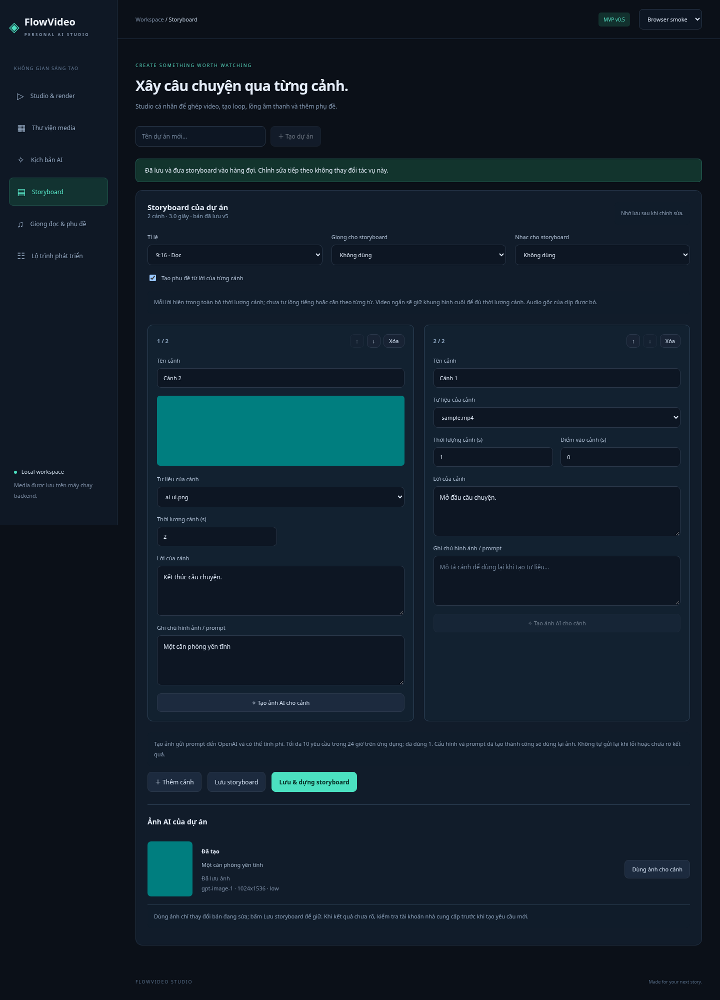

# Tạo ảnh AI cho storyboard



Ảnh chụp kiểm thử dùng ảnh fixture và trạng thái provider mô phỏng, không minh họa chất lượng ảnh từ model thật.

## Sử dụng

Chọn dự án, mở Storyboard, nhập prompt ở một cảnh rồi bấm **Tạo ảnh AI cho cảnh**. Thao tác sẽ lưu storyboard trước khi xếp hàng. Cảnh không cần chọn tư liệu trước. Bạn có thể tiếp tục sửa trong lúc worker tạo ảnh.

Kết quả ở **Ảnh AI của dự án** và Thư viện. Bấm **Dùng ảnh cho cảnh** để thay tư liệu của bản đang sửa, rồi **Lưu storyboard** hoặc **Lưu & dựng storyboard**. Worker không tự sửa cảnh, nên chỉnh sửa bạn làm trong lúc chờ không bị ảnh mới ghi đè. Nếu cảnh đã xóa, ảnh vẫn dùng được qua Thư viện/danh sách tư liệu.

## Cấu hình và giới hạn

Đặt biến môi trường ở backend:

```bash
export OPENAI_API_KEY='your-key'
export OPENAI_IMAGE_MODEL='gpt-image-1'
export IMAGE_DAILY_LIMIT='10'
```

Khởi động lại backend sau khi cấu hình. Không đặt key trong Angular hoặc commit vào Git. `.env.example` không được tự động load. Tài khoản cần quyền sử dụng model; tên model thay thế phải hỗ trợ API/tham số GPT Image tương ứng.

Mỗi lượt gửi một prompt tối đa 4.000 ký tự và tạo một PNG với quality low. Tỉ lệ video dọc chọn ảnh 1024×1536; ngang chọn 1536×1024. Kích thước ảnh không trùng chính xác 9:16/16:9; bộ render vẫn giữ tỉ lệ nguồn và letterbox theo cấu hình video.

Chưa có ảnh tham chiếu, chỉnh sửa ảnh, tạo nhiều biến thể cùng lúc hay tạo video bằng AI.

## Lượt và phí

Mặc định nhận tối đa 10 yêu cầu trong **24 giờ trượt**, tính chung các dự án trong cùng database. IMAGE_DAILY_LIMIT được giới hạn 1–100. Các yêu cầu đã nhận kể cả Failed/Unknown vẫn tính lượt; request bị từ chối trước khi xếp hàng không tính. Đây không phải ngân sách tiền, không bảo đảm phí tối đa ở tài khoản nhà cung cấp. Dịch vụ AI có thể tính phí cho yêu cầu đã gửi kể cả khi ứng dụng không lưu được ảnh.

Cùng mã request và cùng scene/version sẽ trả trạng thái cũ, không gọi lại. Cảnh đang có Queued/Running không nhận lượt khác. Với cùng cảnh, prompt, model, size và quality của một ảnh thành công còn file, hệ thống dùng lại kết quả, không tạo thêm lượt. Muốn ảnh khác, sửa prompt; chưa có nút force regenerate.

## Trạng thái và khôi phục

- **Queued:** đã nhận và lưu vào database; worker sẽ xử lý, kể cả sau restart.
- **Running:** đang gửi/nhận hoặc xác thực ảnh; chưa có tiến độ phần trăm.
- **Succeeded:** ảnh đã lưu vào thư viện.
- **Failed:** provider từ chối hoặc đầu ra/lưu file lỗi. Yêu cầu có thể đã được tính phí; không tự retry.
- **Unknown:** timeout, lỗi mạng hoặc ứng dụng khởi động lại khi job đang Running. Kiểm tra tài khoản/provider trước khi tạo lượt mới; không tự gửi lại hay đối soát kết quả ở provider.

Worker xử lý một ảnh mỗi lần; chưa có hủy/pause hoặc tự thu hồi ảnh từ provider sau Unknown. UI hiển thị 50 yêu cầu theo hoạt động gần nhất của dự án; dùng lại kết quả cũ sẽ đưa nó lên đầu mà không tính lượt mới; nhật ký database giữ đầy đủ. Chỉ chạy một backend trên cùng thư mục data.

## Kiểm thử và nâng cấp

Test provider dùng HTTP handler mô phỏng; PNG được tạo bằng FFmpeg, kiểm tra/giải mã và đưa qua render thật. Browser test mô phỏng trạng thái ảnh, còn lưu project/media và render dùng backend thật. Chưa gọi OpenAI bằng key thật để kiểm chứng chất lượng hay quyền model.

Dừng backend và sao lưu data trước khi nâng cấp. v0.5 thêm bảng/index ImageGenerations bằng lệnh idempotent, giữ project, asset, job và storyboard cũ. Không chia sẻ app lên Internet khi chưa có authentication như giới hạn bản local trong README.
