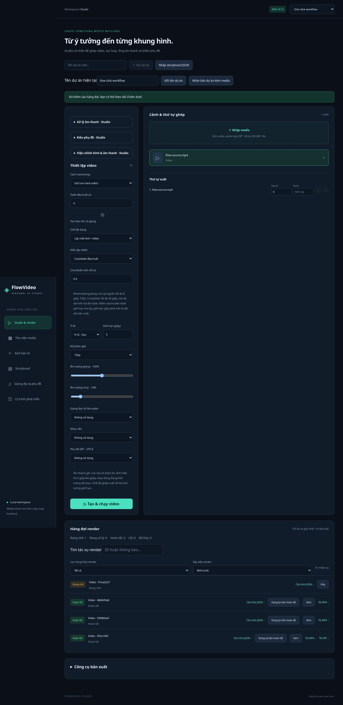

# Loop nâng cao — v0.13

Trong Studio chọn chế độ **Lặp một ảnh/video**, chọn một tư liệu và đặt điểm vào/ra nếu cần. **Giới hạn giây** là độ dài bản xuất; đoạn giữa điểm vào/ra là một chu kỳ nguồn.

| Kiểu | Hành vi | Giới hạn chu kỳ |
|---|---|---|
| Trực tiếp | Lặp nguyên chu kỳ, giữ hành vi cũ. | Theo giới hạn render hiện có. |
| Đảo chiều rồi lặp | Đảo thứ tự frame trong chu kỳ rồi lặp. | Tối đa 8 giây, 720p. |
| Tiến lùi ping-pong | Tiến rồi lùi, bỏ frame đầu/cuối trùng ở nửa đảo. | Tối đa 8 giây, 720p; cần ít nhất 3 frame. |
| Crossfade đầu/cuối | Trộn đuôi với đầu rồi lặp chu kỳ đã xử lý. | Tối đa 30 giây; fade 0,05–2 giây. |

Reverse/ping-pong cần buffer frame, vì vậy giới hạn chu kỳ và độ phân giải để giữ tài nguyên local. Cắt nguồn trước nếu dài hơn giới hạn. Không tự cắt âm thầm cho vừa giới hạn. Thời gian crossfade được lượng tử hóa theo fps; chu kỳ phải dài hơn hai lần fade và một frame.

Crossfade tạo chu kỳ dài xấp xỉ `L - fade`, bắt đầu sau phần head đã dành để trộn. Hai nhánh được đưa về cùng time base và fps cố định trước `xfade`. Độ dài bản xuất vẫn giữ theo yêu cầu, renderer stream-loop chu kỳ xử lý. Crossfade có thể tạo bóng kép; ping-pong có thể làm chuyển động trông ngược tự nhiên. Đây không phải AI tạo chuyển động hay bảo đảm mọi nguồn đều có mối nối đẹp.

Audio gốc trong clip vẫn bị bỏ như pipeline trước; nhạc/giọng từ file trộn riêng, loop video không đảo lời nói hoặc tự tạo audio seamless. Fade đầu/cuối toàn phim tiếp tục hoạt động. Thông số LoopOptions được giữ trong recipe/job, repeat và gói ZIP; không đưa mode loop vào Storyboard (vẫn dựng chuỗi cảnh).

Kiểm thử dùng video hai màu thật: xác nhận thứ tự màu/frame ở nhiều thời điểm cho direct/reverse/ping-pong; crossfade phải có frame trộn và ít thay đổi tại mối nối; mọi đầu ra giữ 4 giây. Kiểm tra options/resolution/cycle budgets và dọn output/temp khi lỗi. Browser chạy cả 3 kiểu mới từ giao diện và kiểm tra recipe sau render.

Nguồn: [FFmpeg reverse, trim, concat, xfade, fps, settb](https://ffmpeg.org/ffmpeg-filters.html), [FFmpeg stream_loop](https://ffmpeg.org/ffmpeg-all.html), đối chiếu 08/11/2026 giờ Việt Nam.
