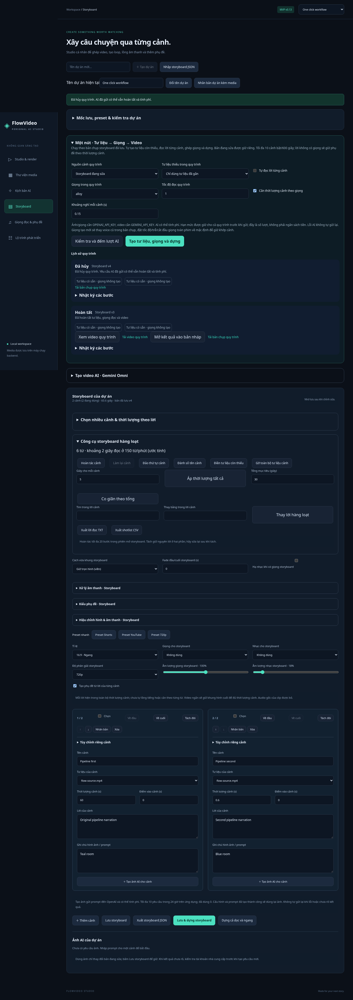

# Quy trình một nút — v0.13

Từ storyboard hoặc kịch bản đã viết, **Tạo tư liệu, giọng và dựng** tạo bản chụp độc lập, tự lấy tư liệu còn thiếu, đọc lời, căn cảnh, ghép giọng và xếp hàng render. Không cần bấm gắn từng kết quả vào cảnh. Bộ điều phối C# và trạng thái SQLite dùng lại worker ảnh/video và renderer sẵn có; không thêm dependency runtime.

## Chức năng đã triển khai

| Nhóm | Hành vi |
|---|---|
| Đầu vào | Dùng storyboard đang sửa hoặc chia mỗi đoạn kịch bản thành một cảnh mới. |
| Kiểm tra trước | Đếm ảnh/video/giọng phải tạo, kết quả dùng lại và hạn mức còn lại; chưa gọi AI. |
| Bản chụp | Lưu script, cảnh, prompt, tư liệu và cấu hình tại lúc bắt đầu; sửa tiếp không đổi lượt đang chạy. |
| Tư liệu có sẵn | Giữ nguyên cảnh đã có ảnh/video, start và hiệu chỉnh riêng. |
| Tạo ảnh | Tự tạo ảnh cho những cảnh chưa gắn tư liệu, theo prompt và tỉ lệ. |
| Tạo video | Tự tạo clip AI còn thiếu; chọn 3–15 giây, 360p/720p/1080p. |
| Dùng lại | Chung fingerprint với chức năng tạo ảnh/video riêng lẻ; chỉ dùng lại kết quả thành công còn file. Cảnh chia từ cùng đoạn kịch bản có ID ổn định để lượt sau dùng lại tư liệu. |
| Giữ hạn mức | Kiểm tra cả batch và lưu tất cả child jobs + run trong một SaveChanges; không enqueue nửa batch khi thiếu quota. |
| Đọc lời | Một lượt TTS cho mỗi cảnh có narration; chọn giọng và tốc độ. |
| Căn thời lượng | Dùng thời lượng audio thực + khoảng nghỉ, làm tròn lên 0,1 giây. |
| Thời lượng cố định | Tắt căn thời lượng để giữ duration cảnh; giọng được trim hoặc đệm im lặng. |
| Cảnh không lời | Đệm im lặng đúng vị trí, không tạo TTS rỗng và không kéo lệch các cảnh sau. |
| Ghép giọng | Lưu giọng từng cảnh và MP3 toàn phim vào thư viện, 48 kHz stereo. |
| Tự dựng | Tự gán kết quả trong bản chụp, đưa vào renderer với nhạc, hiệu chỉnh và phụ đề của storyboard. |
| Theo dõi | Trạng thái, bước từng cảnh, phiên bản đầu vào và nhật ký tối đa 50 sự kiện. |
| Hủy | Hủy child job chưa gửi và dừng render; yêu cầu AI đã gửi có thể vẫn hoàn tất/tính phí. |
| Lỗi tư liệu | Dừng quy trình và hủy sibling Queued thuộc lượt này, không tiếp tục tạo giọng vô ích. |
| Tiếp tục local | Sau restart, chờ lại media Queued/đang có kết quả, dùng lại các bước giọng đã lưu và ghép/dựng local. |
| Tránh tính phí lặp | Speaking bị ngắt chuyển Unknown; lỗi/mất kết nối AI không tự replay. |
| Dựng lại | Nếu bước render lỗi/hủy, tạo render job mới từ cùng recipe mà không tạo lại AI. |
| Xuất và xem | Xem/tải MP4 hoàn tất; tải JSON đầu vào, options, steps, events và storyboard kết quả. |
| Mở kết quả | Đưa kết quả vào bản nháp bằng nút rõ ràng; bấm Lưu nếu muốn thay bản storyboard hiện tại. |

## Dùng thử không cần API key

1. Tạo dự án, nhập một video/ảnh.
2. Trong Storyboard, thêm cảnh và gắn tư liệu, nhập narration nếu muốn có phụ đề.
3. Mở **Một nút · Tư liệu → Giọng → Video**.
4. Chọn **Chỉ dùng tư liệu đã gắn**, tắt **Tự đọc lời từng cảnh**.
5. Có thể bấm **Kiểm tra và đếm lượt AI**, hoặc chạy trực tiếp **Tạo tư liệu, giọng và dựng**.
6. Đợi Hoàn tất rồi xem/tải video trong lịch sử hoặc Studio.

Chế độ offline không tạo giọng nói; narration vẫn có thể thành phụ đề khi AutoCaptions bật. Quy trình không giả lập kết quả AI.

## Dùng AI

Đặt `OPENAI_API_KEY` ở backend để tạo ảnh/giọng, `GEMINI_API_KEY` để tạo video. Không nhập key trong chat hoặc Angular. Cấu hình model dùng chung với các tính năng riêng lẻ. Quy trình video hiện là text-to-video, không tự lấy ảnh đã gắn làm reference; cảnh đã có tư liệu được giữ nguyên.

Chọn nguồn **Mỗi đoạn kịch bản thành một cảnh mới** để bỏ qua danh sách cảnh hiện tại trong bản chụp. Kịch bản cần 1–10 đoạn cách bằng dòng trống, mỗi đoạn tối đa 2.000 ký tự. Nội dung đoạn dùng làm narration và prompt, duration ban đầu 5 giây; đây là chia đoạn xác định, không phải AI viết đạo diễn/phân cảnh. Viết kịch bản từ ý tưởng vẫn là tính năng AI riêng ở tab Kịch bản.

Tối đa 10 cảnh bật, tổng duration của document (kể cả cảnh tắt) 600 giây; tối đa 3 quy trình hoạt động/dự án. Hạn mức ảnh/video dùng chung với chức năng riêng lẻ. `WORKFLOW_TTS_DAILY_LIMIT=20` mặc định, phạm vi 1–100 lượt TTS trong quy trình/24 giờ trên toàn ứng dụng; không bao gồm endpoint TTS riêng lẻ. Mỗi cảnh có lời giữ một lượt từ lúc nhận quy trình. Lượt lỗi/hủy/chưa rõ vẫn tính vào giới hạn. Đây là số lượt, **không phải tiền** và không thay quota của nhà cung cấp.

Căn cảnh theo giọng sẽ giữ nhịp mỗi cảnh theo audio đã tạo. Nếu tắt căn cảnh, lời dài có thể bị cắt: nghe lại trước khi dùng. Voice mới thay VoiceId cũ trong bản chụp; global VoiceSpeed/VoiceDelay/VoiceStart được đặt về 1/0/0 để không phá timeline, các EQ/gain/fade khác vẫn dùng. Phụ đề là nguyên lời cảnh theo thời lượng cảnh, chưa alignment từng từ.

## Khi lỗi hoặc hủy

- Queued chưa gửi có thể dừng; không hứa hoàn tiền hay hủy yêu cầu provider đang chạy.
- Nếu hủy trong lúc TTS đang gửi, audio hoàn tất vẫn lưu thư viện; run giữ Canceled và không tự dựng.
- Unknown cần kiểm tra tài khoản provider; ứng dụng không có nút retry AI ngầm. Bắt đầu run mới là hành động mới, có thể phát sinh phí.
- Render bị ngắt giữa chừng giữ trạng thái Failed như trước; bấm dựng lại local, không gửi thêm AI.
- Retry-render chỉ có khi đã có render job lỗi/hủy. Nó tạo job local mới, giữ recipe cũ và không chạm các bước AI.
- Không tự ghi đè storyboard hiện tại. File nguồn mất sau khi chụp có thể khiến bước render lỗi; khôi phục file hoặc tạo lượt mới với liên kết đúng.

## API

- `GET /api/projects/{id}/workflows`: 20 run gần nhất.
- `POST .../workflows/plan`: kiểm tra số lượt, không enqueue; body ProductionRequest có RequestId, Version và options.
- `POST .../workflows/start`: cùng RequestId/options trả run cũ; dùng lại ID với cấu hình khác trả 409.
- `GET .../workflows/{runId}/snapshot`: JSON input/result và audit; không kèm byte media hoặc key.
- `POST .../workflows/{runId}/cancel`: hủy đang chạy/chờ.
- `POST .../workflows/{runId}/retry-render`: chỉ dựng lại local.

## Tham khảo và kiểm chứng

Đối chiếu tài liệu chính thức ngày 08/11/2026 (giờ Việt Nam): [OpenAI Speech](https://github.com/openai/openai-python/blob/main/src/openai/resources/audio/speech.py), [Google Omni REST](https://aistudio.google.com/docs/omni), [FFmpeg filters — concat, atrim, apad, asetpts](https://ffmpeg.org/ffmpeg-filters.html). Thay vì thêm workflow engine/microservice, bản local dùng state machine SQLite và cập nhật có điều kiện phù hợp ứng dụng một tiến trình.

11 integration tests riêng cho run: offline thật, snapshot isolation, giọng theo cảnh/blank/fixed timing, ảnh cache, script → video, quota nguyên batch, scope/version/idempotency/capacity, Unknown/restart, hủy child và hủy đang TTS, resume từ giọng đã lưu, retry render không gọi AI. Browser kiểm thử workflow offline qua API thật và render/preview/download/snapshot/apply/cancel. AI dùng provider mô phỏng; chưa kiểm chứng chất lượng/quyền model/hóa đơn bằng key thật.
