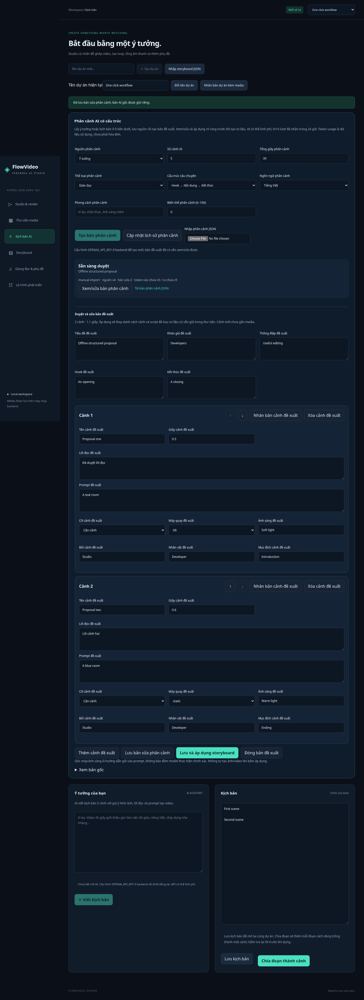
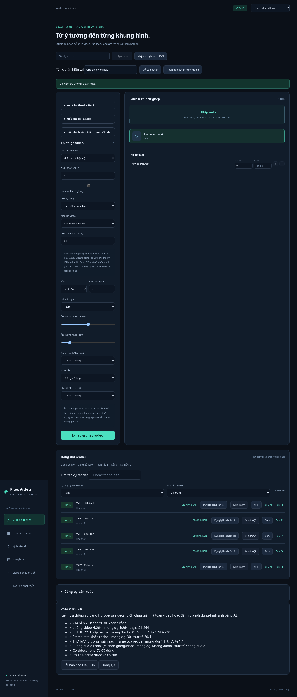

# Phân cảnh có cấu trúc và QA — v0.14



Bản này triển khai phần đầu của lộ trình: ý tưởng/kịch bản → đề xuất phân cảnh → duyệt/sửa → áp dụng vào storyboard → workflow sản xuất hiện có. Thêm QA kỹ thuật tự động sau render. Chưa triển khai toàn bộ 35 module trong bản đề xuất.

## Cách dùng

1. Tạo/chọn dự án, vào **Kịch bản AI** và nhập ý tưởng hoặc nội dung kịch bản ở ô tương ứng.
2. Trong **Phân cảnh AI có cấu trúc**, chọn nguồn, số cảnh, tổng giây, thể loại, cấu trúc, ngôn ngữ và phong cách.
3. Bấm **Tạo bản phân cảnh**. Nguồn được lưu và chụp lại; AI chạy nền, không tự thay storyboard.
4. Chọn **Xem/sửa bản phân cảnh** để sửa tiêu đề, khán giả, thông điệp, hook/kết thúc, lời đọc, prompt, thời lượng và hướng dẫn đạo diễn từng cảnh. Có thêm/xóa/nhân bản/di chuyển cảnh.
5. **Lưu bản sửa** giữ bản AI gốc riêng. Có thể xem bản gốc hoặc tải JSON.
6. **Lưu và áp dụng storyboard** thay danh sách cảnh/script của bản đã lưu bằng phiên bản đã duyệt. Tư liệu cũ vẫn trong thư viện; cảnh mới có ID mới và chưa gắn media. Các cấu hình khung hình/nhạc/giọng hiện tại được giữ.
7. Vào **Một nút · Tư liệu → Giọng → Video**, chọn nguồn **Storyboard đang sửa**, rồi chọn cách tạo tư liệu/giọng và chạy. Không chọn chia đoạn script nếu muốn giữ cấu trúc/hướng dẫn đạo diễn vừa duyệt.

Ứng dụng chỉ áp dụng khi phiên bản bản đề xuất và storyboard còn khớp. Nếu tab khác đã sửa, API trả 409 và giữ các dữ liệu đang có. Việc lưu nguồn và áp dụng là thao tác rõ ràng của người dùng; worker không tự ghi đè.

## Đề xuất và hướng dẫn đạo diễn

Một đề xuất gồm title, audience, message, hook, ending và 1–10 scene. Mỗi scene có title, narration, prompt, duration và direction:

- Cỡ cảnh: establishing, wide, medium, close, extreme-close.
- Máy quay: static, pan, tilt, dolly, zoom, handheld.
- Ánh sáng, địa điểm, nhân vật và mục đích cảnh.

Metadata cấp đề xuất giữ trong lịch sử phân cảnh. Áp dụng đưa narration thành script, scene và direction vào StoryDocument. Metadata direction được giữ qua lưu/JSON/checkpoint/clone như các trường scene khác; Storyboard hiển thị tóm tắt. Shot/camera/lighting/location/characters được ghép vào prompt gửi cho worker ảnh/video và dùng trong fingerprint. Purpose chỉ là mục đích biên tập, không gửi thành lời đọc. Các cảnh cũ có Direction=null giữ prompt/cache như trước.

Đây là hướng dẫn bằng văn bản cho model, không phải điều khiển camera vật lý hay bảo đảm nhân vật/bối cảnh nhất quán. Không có điểm viral/retention giả định.

## Nhập JSON không cần AI key

Nút **Nhập phân cảnh JSON** cho phép dùng đề xuất tự viết hoặc file đã xuất. Tối đa 256 KiB ở giao diện. Không gọi AI, không tính vào quota phân cảnh, tạo ID mới và đánh dấu nguồn `import`/model `manual-import`. Không phục hồi token usage hoặc danh tính provider từ file nhập.

Ví dụ file tối thiểu:

```json
{
  "format": "flowvideo.story-plan",
  "schemaVersion": 1,
  "proposal": {
    "title": "Một mẹo C#",
    "audience": "Developer",
    "message": "Giải thích một ý rõ ràng",
    "hook": "Bạn có gặp lỗi này?",
    "ending": "Thử áp dụng vào ví dụ của bạn",
    "scenes": [{
      "title": "Mở đầu",
      "narration": "Cùng xem một mẹo nhỏ trong C#.",
      "prompt": "A developer in a softly lit workspace",
      "duration": 5,
      "direction": {
        "shot": "medium",
        "camera": "static",
        "lighting": "Soft light",
        "location": "Workspace",
        "characters": "Developer",
        "purpose": "Introduce the topic"
      }
    }]
  }
}
```

File xuất từ lịch sử có `plan.proposal` và `original`; giao diện nhập lấy bản proposal đã sửa. Dữ liệu nhập vẫn qua validation phía server, không tự áp dụng vào project.

## API và giới hạn

- `GET/POST /api/projects/{id}/story-plans`: lịch sử/nhận yêu cầu AI.
- `GET/PUT .../story-plans/{planId}`: xuất toàn bộ bản gốc/nguồn hoặc lưu sửa với revision.
- `POST .../story-plans/{planId}/apply`: áp dụng với revision và version storyboard kỳ vọng.
- `POST .../story-plans/{planId}/cancel`: chỉ hủy Queued chưa gửi.
- `POST .../story-plans/import`: nhận package JSON thủ công.

Cần OPENAI_API_KEY. Model lấy OPENAI_STORY_MODEL → OPENAI_MODEL → `gpt-4o-mini`; cần tài khoản/model hỗ trợ Chat Completions Structured Outputs. Endpoint cố định `/v1/chat/completions`, `response_format=json_schema`, strict=true, mọi object additionalProperties=false, giới hạn 7.000 completion tokens. Kiểm tra JSON và ngữ nghĩa phía server độc lập với schema.

Nguồn 1–12.000 ký tự (idea đã lưu vẫn có giới hạn cũ 4.000), style ≤300, 1–10 cảnh, target 1–600 giây. Kết quả AI phải đúng số cảnh và tổng duration lệch không quá 0,5 giây, đồng thời không vượt 600 giây. Bản sửa thủ công có thể đổi số cảnh/thời lượng trong giới hạn. Tiêu đề ≤120, narration ≤2.000/cảnh, direction text ≤300/trường và prompt cuối ghép metadata ≤4.000 ký tự.

Giới hạn phản hồi 1 MiB/90 giây. JSON sai, thiếu/thừa trường, refusal, finish_reason khác stop, hoặc count/duration sai đều không thành bản có thể áp dụng. Không fallback sang kịch bản văn bản hoặc tự tạo media từ kết quả lỗi.

STORY_DAILY_LIMIT mặc định 10 (1–100) yêu cầu AI đã nhận/24 giờ trên toàn ứng dụng, gồm lỗi/hủy/Unknown; không gồm JSON import, endpoint viết script cũ hoặc các loại AI khác. RequestId chống gửi trùng. Cùng nguồn/model/options dùng lại bản thành công trước kiểm tra quota; tăng Variant 0–100 để yêu cầu phương án khác có thể tính phí. Đây là số lượt, không phải ngân sách tiền. Token vào/ra được lưu khi provider trả về, chưa quy đổi thành hóa đơn.

Worker Queued tiếp tục sau restart; Running → Unknown. Mất mạng/hết thời gian/HTTP 5xx không tự replay. Giao diện giữ editor riêng khi polling, tránh ghi đè bản đang sửa. Mỗi hàng editor có khóa ổn định khi di chuyển/nhân bản; khóa nội bộ không gửi vào proposal API.

## QA kỹ thuật sau render



Mọi render mới chạy kiểm tra trước khi chuyển Succeeded:

- File tồn tại, không rỗng và ffprobe đọc được.
- Video H.264, kích thước/tỉ lệ và fps khớp recipe.
- Duration khớp loop/storyboard trong ngân sách làm tròn frame; concat thông thường không vượt giới hạn đặt.
- Có/không audio đúng theo giọng/nhạc, metadata audio hợp lệ và mono nếu đã chọn.
- Sidecar SRT cần thiết có mặt/parse được. Cue vượt phần hình là warning vì có thể là SRT dùng chung. SRT vượt 1 MiB được ghi warning và bỏ qua phân tích nội dung để giới hạn bộ nhớ.

Lỗi kỹ thuật chặn Succeeded và đi qua cơ chế Failed/dọn output cũ. Báo cáo kiểm tra được lưu độc lập với file; ghi thời điểm và SHA-256 recipe. Bản báo cáo là kết quả tại lúc kiểm tra, không bảo đảm file không bị thay đổi sau đó.

Studio → **Kiểm tra QA** trên job thành công để kiểm tra lại, xem và tải JSON. API `GET /api/jobs/{id}/qa` đọc báo cáo đã lưu; `POST` chạy lại cho job Succeeded. Tối đa 2 phép kiểm tra đồng thời, thời gian probe 20 giây. Không tự sửa/re-render hoặc gọi AI khi kiểm tra lại. Render cũ trước v0.14 chỉ có báo cáo sau khi chạy QA thủ công.

QA này kiểm tra metadata và SRT, **chưa giải mã toàn bộ video, đo LUFS/true peak, tìm frame đen/đứng hình hay đánh giá nội dung/chất lượng hình bằng AI**. Các phát hiện hình ảnh cần phân biệt fade, freeze và loop chủ ý trước khi trở thành lỗi chặn.

## Nguồn và kiểm chứng

Đối chiếu 08/11/2026 giờ Việt Nam:

- [OpenAI Structured Outputs schema](https://github.com/openai/openai-python/blob/main/src/openai/types/shared_params/response_format_json_schema.py).
- [Chat Completions request](https://github.com/openai/openai-python/blob/main/src/openai/types/chat/completion_create_params.py).
- [FFprobe](https://ffmpeg.org/ffprobe.html).

14 tests phân cảnh: hợp đồng schema, dùng lại/quota/idempotency, review revision, apply conflict/scope, giữ bản gốc/storyboard, nhập offline, lỗi provider/refusal/truncation/shape/count/time, restart/cancel. 4 tests QA: báo cáo tự động/recheck/hash, file đổi/mất/hỏng, audio/SRT warning, job chưa xong và direction validation. Tổng suite 122 .NET + 22 Node; full FFmpeg smoke và Playwright. AI dùng mock; chưa gọi API trả phí để kiểm tra quyền model, chi phí, độ trễ hoặc chất lượng đầu ra thật.
