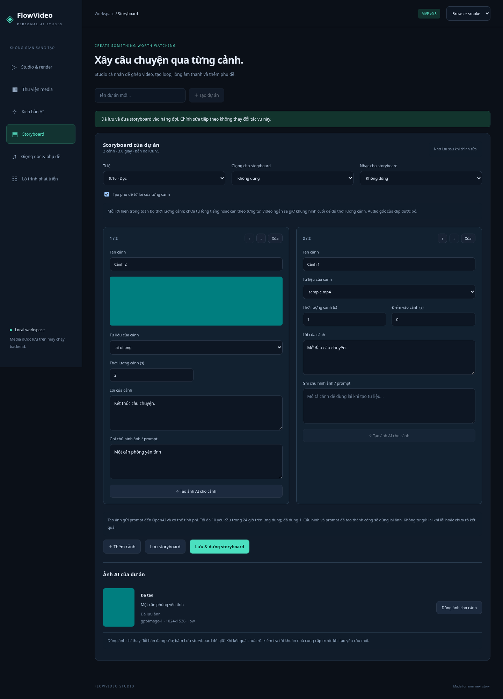

# Storyboard và kịch bản được lưu

## Quy trình

1. Chọn/tạo dự án, nhập ảnh/video/audio ở Studio hoặc Thư viện.
2. Trong Kịch bản AI, viết hoặc tạo nội dung rồi bấm Lưu kịch bản.
3. Chia đoạn thành cảnh: mỗi đoạn cách một dòng trống được thêm thành một cảnh. Đây là chia đoạn theo văn bản, không phải AI tự phân tích lời/hình. Sửa lại lời và ghi chú khi cần.
4. Trong Storyboard, chọn tư liệu cho từng cảnh, chỉnh thời lượng, điểm vào, lời và ghi chú prompt. Dùng nút lên/xuống hoặc xóa/thêm cảnh.
5. Chọn tỉ lệ, giọng/nhạc từ thư viện; bật phụ đề từ lời cảnh nếu muốn.
6. Lưu storyboard hoặc Lưu & dựng storyboard. Theo dõi job trong Studio và tải MP4 khi hoàn tất.

Tạo storyboard/dựng từ tư liệu có sẵn không gọi AI, không cần API key. Giọng đã tạo bằng TTS ở màn hình audio có thể được chọn trong storyboard. Có thể tạo ảnh cho từng cảnh bằng nút riêng; không tự tạo giọng hoặc sinh ảnh/video khi bấm dựng. Xem [ảnh AI](IMAGES.md).

## Thời gian và phụ đề

Mỗi cảnh có thời lượng riêng, từ 0,1 giây; tổng tối đa 600 giây, tối đa 30 cảnh. Ảnh hiển thị theo thời lượng cảnh. Video lấy từ điểm vào; nếu thiếu khung hình, giữ frame cuối cho đủ thời lượng. Một video có thể xuất hiện trong nhiều cảnh với điểm vào/thời lượng khác nhau. Điểm vào phải nằm trong nguồn; vượt nguồn sẽ khiến job lỗi.

Đầu ra 30 fps nên thời gian được lượng tử theo frame. Phụ đề từ lời được căn theo thời lượng part đã normalize, hiển thị toàn cảnh; chưa căn từng từ hoặc theo lời đọc. Lời rỗng không tạo cue. Ghi chú prompt và tên cảnh không được in vào video. Phụ đề này được burn-in, chưa lưu thành file SRT tải riêng. Audio gốc của clip vẫn bị bỏ.

## Lưu và đồng thời

Lưu giữ ý tưởng, kịch bản, các cảnh, thứ tự, tư liệu, thời gian, giọng, nhạc và lựa chọn phụ đề. Mỗi lần thành công tăng số phiên bản. Nội dung chưa lưu có thể mất khi đổi dự án/reload; phiên bản không phải lịch sử phục hồi.

Nếu hai tab cùng sửa một bản, tab lưu sau với phiên bản cũ nhận lỗi 409. Sao chép nội dung cần giữ rồi tải lại bản đã lưu trước khi ghép thay đổi; ứng dụng chưa tự merge. Lưu & dựng lưu trước, sau đó dựng đúng phiên bản đó; nếu tab khác thay đổi giữa hai bước, ứng dụng báo xung đột.

Job chứa snapshot render riêng, nên sửa storyboard sau khi xếp hàng không đổi video đang dựng. Để dùng bản mới, tạo job mới.

## Nâng cấp từ v0.3

Dừng backend và sao lưu toàn bộ thư mục data trước khi nâng cấp. v0.4 thêm bảng ProjectDocuments, giữ nguyên bảng project, asset và job cũ. Database mới được tạo đầy đủ; database cũ được bổ sung bảng bằng câu lệnh idempotent. Chưa hỗ trợ downgrade ứng dụng để chỉnh storyboard; dữ liệu media cũ vẫn giữ nguyên.

Studio dựng thủ công và storyboard là hai luồng riêng. Các lựa chọn trong panel Studio không tự ghi vào storyboard; dùng cấu hình trong storyboard khi dựng từ đó.
