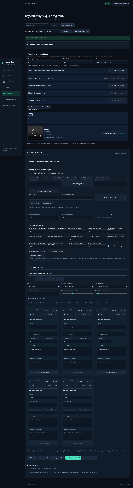

# Tạo video AI trong v0.12

Tích hợp **Google Gemini Interactions API**, mặc định `gemini-omni-1.2-flash`. C# gọi REST trực tiếp bằng HttpClient; không thêm Python worker hay SDK runtime. Kết quả phải là MP4 thực từ dịch vụ; không thay bằng slideshow khi API lỗi.

## Chức năng đã có

1. Tạo video từ prompt đã lưu của từng cảnh.
2. Tạo video với một ảnh tham chiếu PNG/JPEG thuộc dự án.
3. Chọn thời lượng nguyên từ 3–15 giây.
4. Chọn đầu ra 360p/720p/1080p.
5. Dùng tỉ lệ dọc 9:16 hoặc ngang 16:9 của storyboard.
6. Xếp hàng nhiều cảnh bật có prompt bằng một nút; các cảnh đang tạo được bỏ qua.
7. Hàng đợi/lịch sử lưu SQLite và xử lý nền khi chuyển màn hình.
8. Request ID chống gửi trùng, kiểm tra phiên bản storyboard và snapshot prompt/cấu hình.
9. Dùng lại video thành công cùng cảnh/prompt/cấu hình/ảnh tham chiếu khi file còn.
10. Giới hạn lượt nhận trong 24 giờ trên toàn ứng dụng.
11. Hủy lượt còn Queued trước khi gửi dịch vụ.
12. Trạng thái Unknown khi mất mạng/hết thời gian/chạy bị ngắt; không tự gửi lại.
13. Xem trước/tải MP4 và tự bổ sung video thành công vào thư viện.
14. Dùng video cho cảnh bằng thao tác rõ ràng, sau đó lưu/ghép/loop/lồng tiếng/sub bằng pipeline sẵn có.

## Cấu hình và dùng

Đặt `GEMINI_API_KEY` trong môi trường backend. Tùy chọn `GEMINI_VIDEO_MODEL` (mặc định trên) và `VIDEO_DAILY_LIMIT` (mặc định 5, cho phép 1–100). `.env.example` chỉ là mẫu, ứng dụng không tự đọc file đó. Không đặt key trong Angular. Key đi qua header `x-goog-api-key`, không nằm trong URL/log.

Storyboard → nhập prompt cho cảnh → mở **Tạo video AI · Gemini Omni** → chọn thời lượng, độ phân giải và ảnh tùy chọn → **Tạo video AI · [Tên cảnh]** hoặc xếp hàng các cảnh bật.

Ứng dụng lưu storyboard trước khi nhận yêu cầu. Nếu batch vượt hạn mức hoặc một yêu cầu lỗi, các lượt trước đó vẫn được giữ; giao diện báo số yêu cầu đã nhận. Mỗi lượt có thể tính phí. Các lượt lỗi, đã hủy hoặc chưa rõ kết quả vẫn được tính trong giới hạn ứng dụng; đây không phải giới hạn tiền và không thay hạn mức của Google.

Khi xong, chọn **Dùng video cho cảnh** để đổi tư liệu của bản nháp và đưa điểm vào về 0. Thời lượng cảnh vẫn giữ nguyên: renderer có thể cắt bớt hoặc giữ frame cuối để khớp duration. Sau đó **Lưu & dựng storyboard** để ghép với audio/subtitle. Worker không tự ghi đè cảnh, kể cả khi bạn đã sửa/xóa cảnh trong lúc chờ.

## Hợp đồng và giới hạn

- POST cố định `https://generativelanguage.googleapis.com/v1beta/interactions` với `model`, `input`, `response_format` chứa `type: video`, `duration`, `aspect_ratio`, `resolution`.
- Có ảnh: `input` gồm image base64 + text. Ảnh tối đa 10 MiB, kiểm tra PNG/JPEG magic bytes; dịch vụ vẫn có thể từ chối ảnh không giải mã được hoặc không phù hợp.
- Đọc video từ `steps[type=model_output].content[type=video]`, `mime_type=video/mp4`, `data` base64; không nhầm trường SDK-only `output_video`.
- Chờ tối đa 5 phút. Chỉ nhận phản hồi hoàn tất, một video, JSON tối đa 140 MiB, MP4 tối đa 100 MiB. ffprobe kiểm tra H.264, duration >0 và ≤16 giây, chiều 64–4096 px trước khi lưu thư viện. File không đạt bị loại và dọn.
- Một worker video xử lý tuần tự. Queued còn lại tiếp tục khi mở lại ứng dụng. Running chuyển Unknown sau restart để tránh tính phí lặp.
- HTTP 5xx, lỗi mạng/hết thời gian hoặc response chưa hoàn tất chuyển Unknown; lỗi từ chối/JSON/file sai chuyển Failed. Giữ interaction ID phía server nếu nhận được. Không có tự retry hay nút retry ngầm gửi lại.
- Hủy chỉ tác dụng trước khi worker claim lượt; không hứa dừng hoặc hoàn tiền yêu cầu đã gửi.
- Chưa có quản lý tương tác nhiều lượt, sửa/extend video hoặc nhiều ảnh tham chiếu. v0.13 đã bổ sung quy trình riêng tự tạo tư liệu/giọng và ráp từ storyboard/kịch bản, xem [Production](PRODUCTION.md); chưa tự phân cảnh AI từ ý tưởng hoặc đăng bài.

## Nguồn tham khảo chính thức

Đối chiếu ngày 2026-11-07 UTC:

- [Google: Gemini Omni Flash](https://aistudio.google.com/docs/omni) — REST response `steps`, ảnh tham chiếu, duration/aspect ratio/resolution, model hiện tại.
- [Google: video generation](https://ai.google.dev/gemini-api/docs/video-generation) — trang hiện hướng sang Omni và ghi Veo 3.1 Preview đã ngừng.
- [OpenAI Python SDK: videos](https://github.com/openai/openai-python/blob/main/src/openai/resources/videos.py) — thông báo Sora API dự kiến đóng vĩnh viễn 24/09/2026. Không tích hợp endpoint này làm mặc định mới.
- [FFmpeg filters](https://ffmpeg.org/ffmpeg-filters.html) — afftdn, highpass, lowpass, acompressor, atempo, pan, afade, apad, tile.
- [FFprobe](https://ffmpeg.org/ffprobe.html) — kiểm tra metadata và luồng media trước khi dùng kết quả.

## Mức kiểm chứng

Integration tests mô phỏng đúng REST request/response, dùng MP4 H.264 thực do FFmpeg tạo; kiểm tra lưu thư viện, render tiếp, reuse/quota/idempotency/scope và đường lỗi. Browser test mô phỏng phần provider/queue để kiểm tra điều khiển, batch/apply/cancel; tải file và lưu document qua backend thật.

**Chưa gọi Google bằng API key thật.** Quyền model, chi phí, độ trễ và chất lượng hình/tiếng của tài khoản người dùng chưa được xác minh; contract tests không chứng minh chất lượng tạo sinh.
